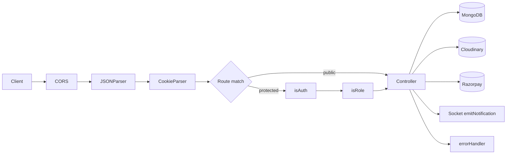
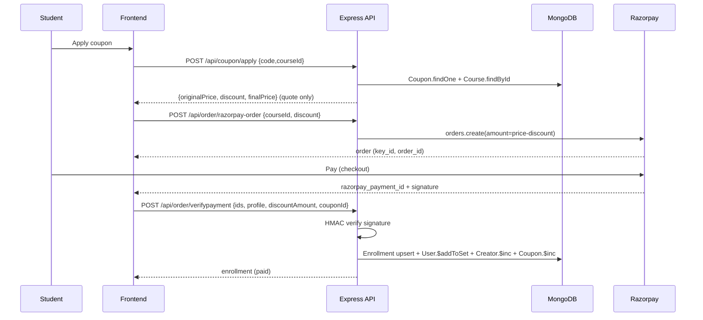
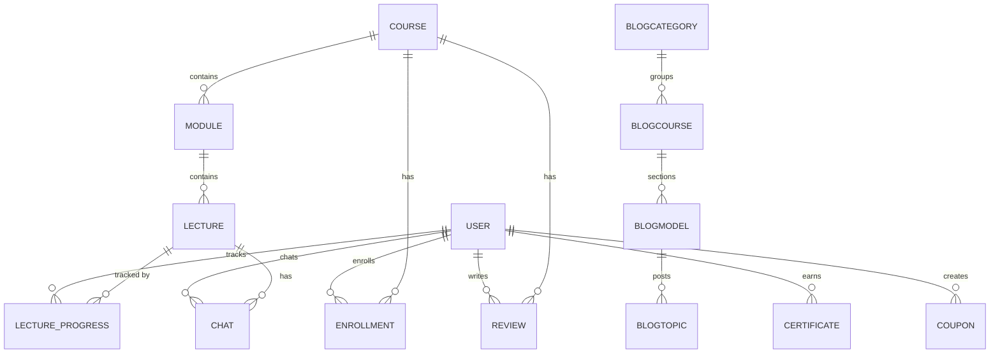

# SkillBridge-LMS — Backend Audit

**Scope:** Complete audit of `backend/` (Node.js + Express 5 + MongoDB/Mongoose 9 + Socket.IO).
**Method:** Every source file was read and verified. Statuses: ✅ Implemented · 🟡 Partial · ❌ Broken · ⚪ Unused/Dead code · ❓ Unverified.
**Date:** 2026-11-25

---

## 1. Backend Folder Structure

```
backend/
├── app.js                     # Express app: middleware + route mounting + error handler
├── index.js                   # Entry point: HTTP server + Socket.IO + DB connect + cleanup cron
├── migrateProgress.js         # One-off migration script (LectureProgress refactor)
├── package.json / package-lock.json
├── eslint.config.js / vitest.config.js
├── README.md                  # ⚠️ Partially outdated vs actual code
├── .env                       # Secrets (NOT audited for values; keys listed only)
├── uploads/                   # Multer disk storage (orphaned files + hls/ leftovers)
│   └── hls/lecture_1779815111855/   # leftover HLS output — proves convertToHLS ran before
├── config/
│   ├── connectDB.js           # mongoose.connect wrapper
│   ├── cloudinary.js          # Cloudinary v2 config + uploadOnCloudinary()
│   ├── token.js               # genToken() — JWT sign
│   ├── sendMail.js            # Nodemailer transporter + 4 email templates
│   ├── createAdmin.js         # ❌ Broken seed script (wrong import path, hardcoded creds)
│   └── createDemoBlogs.js     # Demo blog category seeder (uses MONGO_URI, not MONGODB_URI)
├── middleware/
│   ├── isAuth.js              # JWT verify + ban check + session-expiry check (has debug logs)
│   ├── isRole.js              # Role gate (depends on isAuth having run first)
│   ├── multer.js              # Disk storage → uploads/, 500MB limit, loose file filter
│   └── errorHandler.js        # Final error middleware
├── models/                    # 15 Mongoose models (see §5)
├── routes/                    # 13 route files (see §7)
├── controller/                # 20 controller files (see §6)
├── helpers/
│   ├── enrollmentHelpers.js   # validity calc, enrollment create, expiry sweeper
│   └── notificationHelpers.js # bulk notification builders (some broken — see §11)
├── service/
│   ├── notificationService.js # createNotification / bulk / read / delete / cleanup
│   ├── socketNotificationService.js # io singleton + emit helpers
│   ├── emailNotificationService.js  # ⚪ placeholder (console.log only)
│   └── pushNotificationService.js   # ⚪ placeholder (console.log only)
├── sockets/
│   ├── index.js               # Socket.IO server: "join" room per userId — NO auth
│   └── notificationSocket.js  # ⚪ empty file (0 bytes)
├── utils/
│   ├── calculateProgress.js   # ⚪ unused helper
│   ├── convertToHLS.js        # ⚪ unused ffmpeg HLS converter
│   ├── isCourseActive.js      # ⚪ unused enrollment-active checker
│   └── notificationTypes.js   # NOTIFICATION_TYPES enum constants
├── scripts/createDemoUsers.js # demo user seeder (student/educator/admin, Demo@123)
└── tests/                     # auth.test.js + setup.js (vitest + mongodb-memory-server)
```

---

## 2. package.json & Dependencies

`backend/package.json` — `"type": "module"` (pure ESM), `main: index.js`.

| Dependency | Version | Used for | Status |
|---|---|---|---|
| express | ^5.2.1 | HTTP framework | ✅ |
| mongoose | ^9.6.1 | MongoDB ODM | ✅ |
| jsonwebtoken | ^9.0.3 | JWT auth | ✅ |
| bcryptjs | ^3.0.3 | Password hashing | ✅ |
| cookie-parser | ^1.4.7 | Cookie parsing | ✅ |
| cors | ^2.8.6 | CORS | ✅ |
| dotenv | ^17.4.2 | Env vars | ✅ |
| multer | ^2.1.1 | File upload (disk) | ✅ |
| cloudinary | ^2.10.0 | Media storage | ✅ |
| razorpay | ^2.9.6 | Payments | ✅ |
| socket.io | ^4.8.3 | Realtime notifications | ✅ |
| nodemailer | ^8.0.7 | Email (Gmail SMTP) | ✅ |
| pdfkit | ^0.18.0 | Certificate PDF | ✅ |
| validator | ^13.15.35 | Email validation only | 🟡 minimal use |
| @google/genai | ^2.16.0 | Gemini chatbot | ❓ API usage unverified |
| fluent-ffmpeg + ffmpeg-static | ^2.1.3 / ^5.3.0 | HLS conversion | ⚪ `convertToHLS` never imported |
| hls.js | ^1.6.16 | HLS **client** library | ⚪ misplaced — belongs in frontend |
| nodemon | ^3.1.14 | Dev server | ⚠️ in `dependencies`, should be devDep |

**Dev deps:** eslint 10, vitest 5, supertest 7, mongodb-memory-server 11, globals.

**Scripts:** `start`, `dev`, `seed:demo`, `lint`, `lint:fix`, `test`, `test:watch`.
**Tests:** only `tests/auth.test.js` (signup/login/logout/RBAC). No tests for payments, courses, enrollment, etc.

**Environment variables actually referenced in code:** `PORT`, `MONGODB_URI`, `JWT_SECRET`, `USER_EMAIL`, `USER_PASSWORD`, `ADMIN_EMAIL`, `FRONTEND_URL`, `CLOUDINARY_NAME`, `CLOUDINARY_API_KEY`, `CLOUDINARY_API_SECRET`, `RAZORPAY_KEY_ID`, `RAZORPAY_KEY_SECRET`, `GEMINI_API_KEY`, `CLIENT_URL` (seoController only — inconsistent with FRONTEND_URL), `NODE_ENV`, `MONGO_URI` (only in broken/unused scripts).

---

## 3. Server Startup & Architecture

`index.js`:
1. Creates `http.createServer(app)`.
2. `initializeSocketServer(server)` → Socket.IO `Server` with CORS `[FRONTEND_URL, localhost:5173, vercel.app]`, `credentials: true`.
3. `initializeSocket(io)` stores io in `socketNotificationService` singleton.
4. `server.listen(port)` → inside callback: `connectDb()` → on success runs `deleteOldNotifications()` once, then `setInterval(..., 24h)` repeats it. **Note:** DB connect happens *after* the port is already listening; if Mongo is down the API still serves requests (all DB calls will fail per-request).
5. Default port `8000` (`PORT || 8000`). README says 5000 — outdated.

`app.js` middleware order:
```
express.json() → cookieParser() → cors(whitelist) → 13 routers → GET / health → errorHandler
```
**Missing:** `express.urlencoded`, `helmet`, rate limiting, compression, request logging, `express.static("uploads")` (uploaded files are pushed to Cloudinary anyway, so only orphans remain).

Mermaid — request flow:



---

## 4. MongoDB Connection & Config

`config/connectDB.js` — single function `connectDb()`:
- `mongoose.connect(process.env.MONGODB_URI)` — **no options** (Mongoose 9 defaults: `strictQuery` off etc. are fine, but no timeouts/retry config).
- try/catch only `console.log(error)` — **swallows failure**, server keeps running disconnected. ❌ fragile.

`migrateProgress.js` — standalone script: unsets legacy `isLectureCompleted`/`isQuizCompleted` on Lecture docs, then for every active Enrollment creates `LectureProgress` rows per lecture. Uses `mongoose.model("Module")` implicitly (works because app.js preloads models — but this script imports only Lecture/LectureProgress/Enrollment; `mongoose.model("Module")` will throw `MissingSchemaError` **unless** moduleModel was registered — it isn't imported here → ❌ likely Broken unless run in a context that imports it. Actually `mongoose.model("Module")` requires the model to be registered; `moduleModel.js` is never imported in this file → **confirmed broken**).

---

## 5. Mongoose Models (all fields verified)

### 5.1 `models/userModel.js` → `User`
| Field | Type | Notes |
|---|---|---|
| name | String | required, trim |
| email | String | required, **unique**, lowercase, trim — ⚠️ no format validation at schema level |
| password | String | default null (Google users); hashed with bcrypt(10) in controllers |
| photoUrl, bio(≤500), phone, dateOfBirth | — | profile fields |
| gender | enum | `male/female/other/null` |
| role | enum | `student/educator/admin`, default student |
| isBanned | Boolean | default false |
| isVerified | Boolean | **default true** — email verification effectively disabled |
| resetOtp, otpExpires, isOtpVerifed | — | OTP flow for password reset (plaintext OTP!) |
| enrolledCourses | [ObjectId→Course] | denormalized list |
| totalEarnings | Number | educator earnings |
| lastLogin, currentSessionId, sessionDevice, sessionExpiresAt | — | "single device" session fields |
| timestamps | | createdAt/updatedAt |

### 5.2 `models/courseModel.js` → `Course`
title(req), subTitle, description, category(req), level(enum beginner/intermediate/advanced), price(Number, req, default 0), thumbnail, `validity{value:Number=6, unit:enum day/month/year=month}`, modules[→Module], creator(→User, req), isPublished(false), reviews[→Review]. Index `{category,level,isPublished}`. Legacy `lectures` array commented out.

### 5.3 `models/moduleModel.js` → `Module`
title(req), description, course(→Course, req), lectures[→Lecture]. No `order` field (README claims one — outdated).

### 5.4 `models/lectureModel.js` → `Lecture` — **embedded-heavy design**
- Top: `lectureTitle`(req), `module`(→Module req), `description`, `video{fileUrl,publicId,resourceType,duration,views}`, `isPreviewFree`, timestamps.
- `resources[]`: title, fileUrl, publicId, resourceType, fileType enum(pdf/image/zip/doc), downloads, downloadLogs[{userId,downloadedAt}].
- `quizQuestions[]`: question(req), options[String] (≥2 validator), **correctAnswer(String, req)**.
- `quizAttempts[]`: userId, score, total, correctAnswers, submittedAt — ⚪ **schema exists, no code ever writes to it**.
- `comments[]`: user(→User), message(≤1000), image{fileUrl,publicId}, likes[→User], isPinned, replies[]{user,message≤500,image,likes,createdAt}.
- ⚠️ All content embedded in one document → 16MB doc limit risk, no pagination on comments/quiz.

### 5.5 `models/enrollmentModel.js` → `Enrollment`
user(→User,req,idx), course(→Course,req,idx), coupon(→Coupon), couponCode, originalPrice(req), discountAmount, pricePaid(req), studentName/studentEmail/studentPhone(req), paymentId, orderId, paymentMethod("razorpay"), paymentStatus enum(pending/paid/failed), startDate, endDate(req), status enum(active/expired).
**Unique index `{user:1, course:1}`** — see §11 bug: blocks re-enrollment after expiry via `Enrollment.create`.

### 5.6 `models/lectureProgressModel.js` → `LectureProgress`
user(→User,req,idx), lecture(→Lecture,req,idx), currentPosition, watchTime, maxPosition, progressPercent(0–100), completed+completedAt, isLectureCompleted+lectureCompletedAt, isQuizCompleted+quizCompletedAt, lastAccessedAt. **Unique `{user,lecture}`**.

### 5.7 `models/notificationModel.js` → `Notification`
recipient(→User,req,idx), recipientRole enum, sender, title(≤150), message(≤1000), type(enum=NOTIFICATION_TYPES values), category enum(15 values, default system), actionUrl, resourceType enum, resourceId, isRead/readAt, channels{inApp,email,push,sms}, deliveryStatus{per-channel pending/sent/failed}, priority(low/medium/high/critical), metadata Mixed, expiresAt + **TTL index expireAfterSeconds:0**. 6 secondary indexes.

### 5.8 `models/reviewModel.js` → `Review`
course(→Course), user(→User), rating(Number, **`require:true` typo — not actually required**, min1 max5), comment, reviewedAt, timestamps. No unique user+course index (dup check done in controller).

### 5.9 `models/couponModel.js` → `Coupon`
code(req,unique,uppercase), discountType(fixed/percentage), discountValue(req), maxDiscount, minPurchase, expiryDate(req), usageLimit(100), usedCount, usedBy[→User], isActive, couponFor(all/specific), applicableCourses[→Course], createdBy(→User,req), creatorRole(admin/educator). Virtual `isExpired`. Index on expiryDate.

### 5.10 `models/certificateModel.js` → `Certificate`
user(→User,req), course(→Course,req), certificateId(unique,req, format `CERT-XXXXXXXX`), issuedAt, pdfUrl(default null — **never written**), progressPercent. Unique `{user,course}`.

### 5.11–5.14 Blog hierarchy: `BlogCategory → BlogCourse → BlogModel → BlogTopic`
- **BlogCategory**: name(unique), slug(unique), description, icon, blogCourses[→BlogCourse], creator(→User req), isPublished. Index {slug,isPublished}.
- **BlogCourse**: name, slug(unique), description, thumbnail, blogModels[→BlogModel], blogCategory(→BlogCategory req), creator(req), isPublished.
- **BlogModel**: title, slug(unique), description, blogTopics[→BlogTopic], blogCourse(req), creator(req), isPublished.
- **BlogTopic**: title, slug(unique), content(req), excerpt, thumbnail, blogModel(req), creator(req), views, likes[→User], comments[]{user,message≤1000,likes,replies{user,message≤500,likes}}, isPublished, tags[]. Indexes {slug,blogModel,isPublished}, {tags}.

### 5.15 `models/chatboatModel.js` → `Chat` (note filename typo "chatboat")
lectureId(→Lecture req), lectureTitle(req), userId(→User req), messages[]{role(user/assistant),content,timestamp,isFavorite}, isFavorite, createdAt/updatedAt + pre-save hook. **No indexes** (queries filter userId+lectureId — will collection-scan).

---

## 6. Controllers — Function-by-Function

### `controller/authController.js`
| Function | Route | Purpose / Flow | Status |
|---|---|---|---|
| `signUP` | POST /api/auth/signup | Validates name/email(validator.isEmail)/password≥8 → checks dup → bcrypt.hash(10) → `User.create` **with `role` taken from req.body** → generates JWT + `currentSessionId`(crypto.randomBytes 32) + sessionExpiresAt(+7d) → sets httpOnly cookie → returns user (password excluded) + token + sessionId | ✅ works — ❌ **privilege escalation: client can send `role:"admin"`** |
| `login` | POST /api/auth/login | findOne email → auto-set isVerified=true → ban check → bcrypt.compare → new session fields → cookie + token | ✅ — ❌ returns token in body AND cookie; no rate limit |
| `logOut` | GET /api/auth/logout | Clears session **only if `req.user` exists — but route has NO isAuth middleware, so `req.user` is always undefined → session fields never cleared**; clears cookie | ❌ partially broken |
| `sendOtp` | POST /api/auth/sendotp | Finds user → `Math.random()` 6-digit OTP → stores **plaintext** resetOtp, otpExpires=+5min → `sendMail` | 🟡 works but weak (non-CSPRNG, no attempt limit, no rate limit) |
| `varifyOTP` | POST /api/auth/verifyotp | Compares resetOtp, expiry → sets isOtpVerifed=true, clears otp | ✅ (typo in name kept) |
| `resetPassword` | POST /api/auth/resetpassword | Requires isOtpVerifed → bcrypt.hash → resets flag. **No password length/strength validation** | 🟡 |
| `googleAuth` | POST /api/auth/googleauth | **Trusts client-sent {name,email,photoUrl,role} — NO Google ID-token verification.** Creates/updates user, sets session, returns `user` **full doc incl. password hash for existing users** | ❌ Critical security issue |
| `clearSession` | POST /api/auth/clearsession | **Unauthenticated** — anyone can wipe any user's session by email | 🟡 abuse-able (logout DoS) |

### `controller/userController.js`
| Function | Route | Notes | Status |
|---|---|---|---|
| `getCurrentUser` | GET /api/user/getcurrentuser | Excludes password/OTP fields, populates enrolledCourses | ✅ |
| `updateProfile` | PUT /api/user/updateprofile | multer `photo` → Cloudinary → selective field update | ✅ — ⚠️ `uploaded.fileUrl` crashes if Cloudinary returns null |
| `changePassword` | PUT /api/user/changepassword | Requires old password; blocks Google users (password null) | ✅ — doesn't invalidate other sessions |
| `getEnrolledCourses` | GET /api/user/enrolledcourses | Populates courses + creator | ✅ |
| `deleteAccount` | DELETE /api/user/deleteaccount | `findByIdAndDelete` — **orphans enrollments, lectures, courses, blogs** | 🟡 |
| `getUserById` | GET /api/user/:userId | Admin-only route; excludes secrets | ✅ |

### `controller/courseController.js`
| Function | Route(s) | Notes | Status |
|---|---|---|---|
| `createCourse` | POST /api/course/create | Creates course + **loops ALL students creating a Notification each** (N writes; will not scale) | ✅ perf concern |
| `togglePublishCourse` | PUT publish & unpublish | Flips isPublished; broadcasts to all students on publish | ✅ |
| `getPublishedCourses` | GET /api/course/getpublished | **Public route (no isAuth) → `req.userId` undefined → progress merge is dead code.** Deep-populates modules→lectures→reviews (heavy) | 🟡 |
| `getCreatorCourses` | GET /api/course/getcreator | Educator's own courses + progress merge | ✅ |
| `getCreatorById` | POST /api/course/creator | isAuth only, returns user minus password — **exposes email publicly** | 🟡 |
| `editCourse` | PUT /api/course/editcourse/:courseId | Field updates + thumbnail→Cloudinary + `validity.value/unit` form fields | ✅ — ⚠️ **no ownership check: any educator edits any course** |
| `getCourseById` | GET /api/course/getcourse/:courseId | **Public → leaks full module/lecture structure incl. video URLs, quiz answers, resources to non-enrolled users** | ❌ paywall bypass |
| `deleteCourse` | DELETE /api/course/remove/:courseId | Deletes course only — **orphans modules/lectures/reviews/enrollments**; no ownership check | 🟡 |
| `getAllCourses` | GET /api/course/all-courses | Admin only | ✅ |

### `controller/moduleController.js`
| Function | Route | Notes | Status |
|---|---|---|---|
| `createModule` | POST /create-module/:courseId | Creates Module, pushes id into course.modules | ✅ — no ownership check |
| `getCourseModules` | GET /course-modules/:courseId | **Public** — returns modules+lectures with computed stats; again leaks content | 🟡 |
| `removeModule` | DELETE /remove-module/:moduleId | Deletes lectures inside (DB only — **Cloudinary files orphaned**), pulls from course | 🟡 |
| `removeAllModules` | DELETE /remove-all-modules/:courseId | Same; clears course.modules | 🟡 |

### `controller/lectureController.js`
| Function | Route | Notes | Status |
|---|---|---|---|
| `createLecture` | POST /createlecture/:moduleId | Creates lecture, pushes into module.lectures | ✅ |
| `getCourseLectures` | GET /courselecture/:moduleId | **Requires educator role — students cannot call it** (frontend must use course-modules instead) | 🟡 design smell |
| `editLecture` | POST /editlecture/:lectureId | Video upload: destroys old Cloudinary asset, uploads new via `uploadOnCloudinary` (extension-based resource_type) | ✅ |
| `removeLectureVideo` | DELETE /remove-lecture-video/:lectureId | Destroys Cloudinary video, clears `lecture.video` | ✅ |
| `removeLecture` | DELETE /removelecture/:lectureId | Destroys video+resources on Cloudinary, deletes doc, `$pull` from `Course.lectures` — **but lectures live on Module, not Course → pull is a no-op; module.lectures keeps dangling id** | ❌ partial bug |
| `markLectureCompleted` | PUT /mark-lecture-completed/:lectureId | Upserts LectureProgress.isLectureCompleted | ✅ — **no enrollment check** |
| `markQuizCompleted` | PUT /mark-quiz-completed/:lectureId | Upserts isQuizCompleted — **no quiz is actually taken/graded** | 🟡 fake completion |

### `controller/uploadLectureResource.js`
| Function | Route | Notes | Status |
|---|---|---|---|
| `uploadLectureResource` | POST /upload-resource/:lectureId | `upload.array("files",20)` → per-file Cloudinary → pushes resource subdocs w/ fileType detection | ✅ |
| `downloadResource` | GET /download-resource/:lectureId/:resourceId | **Enrollment check explicitly removed** ("Anyone can download") → increments downloads + downloadLogs → returns `fileUrl?fl_attachment` | 🟡 intentional but insecure |
| `removeResource` | DELETE /removeresource/:lectureId/:resourceId | Cloudinary destroy + pull | ✅ |
| `getLectureResources` | GET /lecture-resources/:lectureId | Returns resources (incl. fileUrls) to any authenticated user | 🟡 |

### `controller/progressController.js`
Exports 2 helpers + 3 endpoints.
- `mergeUserProgressWithLectures(lectures,userId)` / `mergeUserProgressWithModules(modules,userId)` — batch-fetch LectureProgress, merge flags into lecture objects. Used by course/module/lecture GETs. ✅
- `updateLectureProgress` — POST /progress/update. **Route has NO isAuth → `req.userId` undefined → `LectureProgress` save fails (user required) → effectively ❌ Broken.** Also trusts client `currentPosition` (no server duration validation, auto-complete at ≥95% of `video.duration` which is Cloudinary-reported).
- `getCourseProgress` — GET /progress/course/:courseId. **No isAuth → counts progress for `user: undefined` → returns zeros.** ❌ Broken.
- `resumeLecture` — GET /progress/resume/:courseId. Same auth problem → always returns `lecture:null`. ❌ Broken.

### `controller/quizController.js`
- `addQuizQuestion` (educator) / `removeQuizQuestion` (educator) / `getLectureQuiz` (any auth).
- **`getLectureQuiz` returns `quizQuestions` including `correctAnswer` → students can read answers.** ❌
- **No quiz submission/scoring endpoint exists**; `quizAttempts` schema unused; `markQuizCompleted` just sets a flag. 🟡 Quiz system is Partial/Broken end-to-end.

### `controller/commentController.js`
All lecture-embedded comments. Heavy `console.log` debug noise in every function.
- `addComment`, `getLectureComments` (sorts pinned first), `addReply` — ✅ basic.
- `removeComment`/`removeReply` — owner-only delete; **educator cannot moderate**; `comment.user.toString() !== userId.toString()` comparison OK.
- `toggleCommentLike`/`toggleReplyLike` — `likes.includes(userId)` compares ObjectId **instances** → likely always false → like/unlike toggle broken (pull won't match either). ❓ probable bug.
- `togglePinComment` — route comment says educator-only but middleware is only `isAuth` → **any user can pin** ❌.

### `controller/certificateController.js`
- `generateCertificate` — counts completed lectures via `LectureProgress.completed` **plus** legacy `Lecture.isLectureCompleted` field (dead — field no longer exists → always 0; `Math.max` saves it). Requires ≥70% → creates Certificate w/ `CERT-`+8 hex. ✅
- `getCertificate`, `getAllCertificates` — ✅.
- `downloadCertificate` — streams PDFKit-generated A4 landscape certificate (decorative borders, seal, signatures). `pdfUrl` never used — generated on the fly each download. ✅ — filename uses raw `course.title` in Content-Disposition (⚠️ quote-injection cosmetic).

### `controller/enrollMentController.js`
- `enrollCourse` — free courses only (`price>0` rejected). Expires stale enrollments, checks active dup, `calculateEnrollmentEndDate(course.validity)`, `createEnrollment` (also `$addToSet` user.enrolledCourses), `sendEnrollmentNotifications`. **❌ Bug: `Enrollment.create` hits unique `{user,course}` index if user ever enrolled before (even expired) → 500 duplicate-key instead of re-enroll.**
- `getUserEnrollments` — sweeps expired, populates course+creator, computes isExpired/daysRemaining. ✅ (mounted twice: `/api/enrollment/user` and `/api/course/user-enrollments`)
- `checkEnrollmentStatus` — latest enrollment → auto-expire + `$pull` from user → returns status/daysRemaining. ✅

### `controller/orderController.js` (Razorpay)
- `RazorPayOrder` — POST /api/order/razorpay-order. Reads `{courseId, discount}` from **client** → `finalPrice = course.price - discount` → creates Razorpay order (amount×100, INR). ❌ **Client-controlled discount = price manipulation.**
- `VerifyPayment` — POST /api/order/verifypayment. Verifies HMAC-SHA256 signature (`order_id|payment_id`) ✅. Then upserts Enrollment via `findOneAndUpdate({user,course},{...},{upsert:true})`, `$addToSet` enrolledCourses, `$inc` educator totalEarnings, coupon usedCount/usedBy, sends notifications.
  - ❌ **Critical:** order is never persisted server-side and **amount paid is never verified** — a payment signature for a cheap course's order can be replayed with an expensive `courseId` (signature only covers order_id+payment_id).
  - ❌ `discountAmount`, `originalPrice`, `couponId` all client-supplied → fake coupon/discount accepted; coupon `isActive`/expiry/ownership not re-validated at verify time.
  - 🟡 No transaction: enrollment+earnings+coupon updates can partially fail.
  - ⚠️ `console.log("Razorpay Key:", ...)` logs key id at boot.

### `controller/couponController.js`
`createCoupon` (admin/educator; educator ownership check only when `couponFor:"specific"` — **educator can create "all"-courses coupons affecting competitors' courses** ❌), `applyCoupon` (validation + discount math, returns quote only — not bound to payment), `getAllCoupons` (admin), `getMyCoupons` (educator), `getSingleCoupon` (any auth — leaks coupon details), `updateCoupon` (**passes `req.body` straight to findByIdAndUpdate → mass assignment: can rewrite createdBy/usedCount/discountValue** ❌), `deleteCoupon`, `toggleCouponStatus` (educator ownership enforced for update/delete/toggle ✅).

### `controller/reviewController.js`
- `createReview` — auth; dup check per user+course; pushes review id into course.reviews. **No enrollment check** 🟡.
- `getReviews` — GET /api/review/getreview **returns ALL reviews ignoring course filter** (no courseId param used) 🟡; populates `user."description"` — field doesn't exist.

### `controller/notificationController.js`
`getMyNotifications` (paginated, last-15-days filter), `getUnreadCount`, `markAsRead`, `markAllAsRead`, `deleteNotification`, `deleteAllNotifications` — all scoped by `req.userId`, ownership enforced in queries ✅. Duplicates service-layer functions (service versions unused by routes).

### `controller/dashboardController.js`
- `getDashboardStats` — educator dashboard: courses by creator → enrollments → unique students, earnings sum, avg progress (batch queries + in-memory maps ✅ decent), totalDownloads, recentEnrollments(30d), per-course enrollment counts via `Promise.all` (N+1 count queries 🟡). Route: GET /api/course/dashboard-stats (any auth — students get empty stats).
- `getRecentEnrollments` — educator, last 10 enrollments w/ user+course populate. ✅

### `controller/adminController.js`
`getAllUsers` (excludes admins), `getAllStudents`, `getAllEducators`, `banUser`/`unbanUser` (can't ban admin), `deleteUser` (can't delete admin), `changeUserRole` (student↔educator only, can't touch admin), `getAllCourses`, `deleteCourse`, `toggleCoursePublish`, `getPlatformStats`. All behind `isAuth + isRole("admin")` ✅. Heavy console.log noise.

### `controller/blogController.js` (~890 lines, 24 exports)
Full CRUD hierarchy for BlogCategory → BlogCourse → BlogModel → BlogTopic + likes/comments/replies. Mirrors course structure.
- ✅ Create/toggle/delete wired; parent `$pull` cleanup on deletes.
- ❌ **No ownership checks anywhere** — any educator can edit/delete ANY educator's categories/courses/models/topics.
- ❌ **Public GETs don't filter `isPublished`** at topic/model/course level consistently (`getBlogCategoryById`, `getBlogCourseById`, `getBlogModelById`, `getBlogTopicsByModel`, `getBlogTopicById` return unpublished content).
- ❌ `deleteBlogComment`/`deleteBlogReply` — **zero ownership/role checks despite route comment claiming "Educator/Admin or owner"** — anyone authenticated deletes anyone's comment.
- `getBlogTopicById` increments `views` on every fetch (incl. refresh bots) 🟡.
- `editBlogTopic` supports thumbnail→Cloudinary ✅.

### `controller/seoController.js`
- `generateSitemap` — GET /sitemap.xml (mounted at `/` via seoRoute). Static URLs + published courses + published blog topics (3-level populate) + educator profiles. Uses `process.env.CLIENT_URL` — **env actually defines FRONTEND_URL → falls back to hardcoded `https://skillbridge-lms.com`** ❌ wrong domain risk.
- `generateRobotsTxt` — GET /robots.txt, same CLIENT_URL issue.

### `controller/chatbotController.js` (Gemini AI)
- `chatWithAI` — POST /api/chatbot/chat. Builds system prompt (lecture title + markdown rules) → `new GoogleGenAI({apiKey: GEMINI_API_KEY})` → **`ai.interactions.create({model:"gemini-3.6-flash", input, previous_interaction_id})`** — ❓ this Interactions API/model name is unverified against `@google/genai` v2 docs (standard API is `ai.models.generateContent` with e.g. `gemini-2.0-flash`); likely Broken if model id invalid.
- `saveChat`, `getChatHistory`, `getChat`, `deleteChat`, `getAllUserChats`, `toggleChatFavorite`, `toggleMessageFavorite` (array-index param — fragile), `getFavoriteChats` — all scoped `req.user._id` ✅.
- Chat responses are **not auto-saved** — client must call /save separately 🟡.

### `controller/searchController.js` — ⚪ **empty file (0 bytes), never routed.**

---

## 7. Complete API Route Tables

Base mount points from `app.js`. Legend: 🔓 public · 🔐 auth · 🛡 role.

### `/api/auth` (authRoute.js)
| Method | Endpoint | Controller | Middleware | Req → Res |
|---|---|---|---|---|
| POST | /signup | signUP | — | {name,email,password,role?} → 201 {user,token,sessionId} + cookie |
| POST | /login | login | — | {email,password} → 200 {user,token,sessionId} + cookie |
| GET | /logout | logOut | — | clears cookie (session clear broken) |
| POST | /sendotp | sendOtp | — | {email} → OTP email |
| POST | /verifyotp | varifyOTP | — | {email,otp} → verified flag |
| POST | /resetpassword | resetPassword | — | {email,password} → reset |
| POST | /googleauth | googleAuth | — | {name,email,photoUrl,role} → user+token (no token verify!) |
| POST | /clearsession | clearSession | — | {email} → clears session (unauthenticated) |

### `/api/user` (userRoute.js)
| Method | Endpoint | Controller | Middleware |
|---|---|---|---|
| GET | /getcurrentuser | getCurrentUser | isAuth |
| PUT | /updateprofile | updateProfile | isAuth + multer.single("photo") |
| PUT | /changepassword | changePassword | isAuth |
| GET | /enrolledcourses | getEnrolledCourses | isAuth |
| DELETE | /deleteaccount | deleteAccount | isAuth |
| GET | /:userId | getUserById | isAuth + isRole("admin") |

### `/api/course` (courseRoute.js) — largest router
| Method | Endpoint | Controller | Middleware | Notes |
|---|---|---|---|---|
| POST | /create | createCourse | auth+educator | notifies all students |
| GET | /getcreator | getCreatorCourses | auth+educator | |
| PUT | /editcourse/:courseId | editCourse | auth+educator+multer thumbnail | no ownership check |
| GET | /getcourse/:courseId | getCourseById | 🔓 | leaks content |
| DELETE | /remove/:courseId | deleteCourse | auth+educator | orphans children |
| GET | /user-enrollments | getUserEnrollments | auth | dup of /api/enrollment/user |
| GET | /recent-enrollments | getRecentEnrollments | auth+educator | |
| GET | /getpublished | getPublishedCourses | 🔓 | progress merge dead (no auth) |
| GET | /all-courses | getAllCourses | auth+admin | |
| PUT | /publish/:courseId | togglePublishCourse | auth+educator | |
| PUT | /unpublish/:courseId | togglePublishCourse | auth+educator | same handler |
| POST | /creator | getCreatorById | auth | body.userId → user |
| POST | /create-module/:courseId | createModule | auth+educator | |
| DELETE | /remove-module/:moduleId | removeModule | auth+educator | |
| DELETE | /remove-all-modules/:courseId | removeAllModules | auth+educator | |
| GET | /course-modules/:courseId | getCourseModules | 🔓 | leaks lectures |
| POST | /createlecture/:moduleId | createLecture | auth+educator | |
| GET | /courselecture/:moduleId | getCourseLectures | auth+educator | students blocked |
| POST | /editlecture/:lectureId | editLecture | auth+educator+multer videoUrl | |
| DELETE | /removelecture/:lectureId | removeLecture | auth+educator | module.lectures dangling |
| DELETE | /remove-lecture-video/:lectureId | removeLectureVideo | auth+educator | |
| PUT | /mark-lecture-completed/:lectureId | markLectureCompleted | auth | no enrollment check |
| PUT | /mark-quiz-completed/:lectureId | markQuizCompleted | auth | flag only |
| POST | /upload-resource/:lectureId | uploadLectureResource | auth+educator+multer files×20 | |
| DELETE | /removeresource/:lectureId/:resourceId | removeResource | auth+educator | |
| GET | /download-resource/:lectureId/:resourceId | downloadResource | auth | no enrollment check |
| GET | /lecture-resources/:lectureId | getLectureResources | auth | |
| POST | /add-quiz/:lectureId | addQuizQuestion | auth+educator | |
| DELETE | /remove-quiz/:lectureId/:quizId | removeQuizQuestion | auth+educator | |
| GET | /get-quiz/:lectureId | getLectureQuiz | auth | **returns correctAnswer** |
| POST | /comment/:lectureId | addComment | auth | |
| DELETE | /comment/:lectureId/:commentId | removeComment | auth | owner only |
| GET | /comment/:lectureId | getLectureComments | auth | |
| POST | /comment/reply/:lectureId/:commentId | addReply | auth | |
| DELETE | /comment/reply/:lectureId/:commentId/:replyId | removeReply | auth | owner only |
| PUT | /comment/like/:lectureId/:commentId | toggleCommentLike | auth | probable ObjectId bug |
| PUT | /comment/reply/like/:lectureId/:commentId/:replyId | toggleReplyLike | auth | same |
| PUT | /comment/pin/:lectureId/:commentId | togglePinComment | auth | **should be educator** |
| POST | /progress/update | updateLectureProgress | 🔓 **missing isAuth** | ❌ broken |
| GET | /progress/course/:courseId | getCourseProgress | 🔓 missing isAuth | ❌ returns zeros |
| GET | /progress/resume/:courseId | resumeLecture | 🔓 missing isAuth | ❌ always null |
| POST | /certificate/generate/:courseId | generateCertificate | auth | |
| GET | /certificate/:courseId | getCertificate | auth | |
| GET | /certificate/download/:courseId | downloadCertificate | auth | +OPTIONS handler |
| GET | /dashboard-stats | getDashboardStats | auth | |

### `/api/order` (paymentRoute.js)
| POST | /razorpay-order | RazorPayOrder | auth | {courseId,discount} — client-trusted discount |
| POST | /verifypayment | VerifyPayment | auth | signature verify + enroll upsert |

### `/api/enrollment` (enrollmentRoute.js)
| POST | /enroll/:courseId | enrollCourse | auth | free courses only |
| GET | /user | getUserEnrollments | auth | |
| GET | /check/:courseId | checkEnrollmentStatus | auth | |

### `/api/certificate` (certificateRoute.js) — duplicates course-mounted certs
GET / , GET /:courseId, GET /download/:courseId, POST /generate/:courseId — all isAuth.

### `/api/review`
POST /createreview (auth), GET /getreview (🔓 returns ALL reviews).

### `/api/coupon` (coupon.routes.js)
POST /create (admin+educator), POST /apply (auth), GET /all (admin), GET /my-coupons (educator), GET /:id (auth), PUT /update/:id (admin+educator), DELETE /delete/:id, PATCH /toggle/:id.

### `/api/admin` (adminRoute.js) — all `isAuth+isRole("admin")`
GET /users, /students, /educators, /courses, /stats · PUT /ban/:userId, /unban/:userId, /role/:userId · DELETE /user/:userId, /course/:courseId · PUT /course/publish/:courseId.

### `/api/notification` (notificationRoutes.js) — all isAuth
GET / , GET /unread-count, PATCH /:id/read, PATCH /read-all, DELETE /:id, DELETE /.

### `/api/blog` (blogRoute.js) — 24 endpoints
Categories: POST /category/create (educator), GET /categories 🔓, GET /categories/creator, GET /category/:id 🔓, PUT /category/:id, PUT /category/publish/:id, DELETE /category/:id.
Courses: POST /course/create/:blogCategoryId, GET /courses/:blogCategoryId 🔓, GET /course/:blogCourseId 🔓, PUT /course/publish/:id, DELETE /course/:id.
Models: POST /model/create/:blogCourseId, GET /models/:blogCourseId 🔓, GET /model/:id 🔓, PUT /model/publish/:id, DELETE /model/:id.
Topics: POST /topic/create/:blogModelId, GET /topics/:blogModelId 🔓, GET /topic/:id 🔓, PUT /topic/edit/:id (+thumbnail), PUT /topic/publish/:id, DELETE /topic/:id, PUT /topic/like/:id (auth), POST /topic/comment/:id, POST /topic/comment/reply/:id/:commentId, PUT like comment/reply, DELETE comment/reply.

### Root mounts
GET /sitemap.xml, GET /robots.txt (seoRoute at `/`), GET / → "Hello from Server".

### `/api/chatbot` (chatbotRoute.js) — all isAuth
POST /chat, POST /save, GET /history/:lectureId, GET /chat/:chatId, DELETE /chat/:chatId, GET /all-chats, PUT /favorite/:chatId, PUT /favorite/:chatId/:messageIndex, GET /favorites.

---

## 8. Authentication, JWT, Cookies, Hashing, RBAC

- **JWT:** `genToken(userId)` → `jwt.sign({userId}, JWT_SECRET, {expiresIn:"7d"})`. Cookie `token` httpOnly; `secure`+`sameSite:"None"` only in production, else `Lax`. Token **also returned in response body** (usable via `Authorization: Bearer` — isAuth supports both).
- **Password:** bcryptjs hash rounds=10 everywhere consistently.
- **isAuth flow:** cookie→Bearer fallback → `jwt.verify` → `User.findById(decoded.userId).select("_id role isBanned currentSessionId sessionExpiresAt")` → ban check → sessionExpiresAt check (clears fields if expired) → sets `req.user={_id,role}` + `req.userId`.
- **isRole(...roles):** reads `req.user.role`; must run after isAuth.
- **RBAC roles:** student / educator / admin. Educator gates are role-only — **no resource-ownership checks** (see §10).
- **Session model:** `currentSessionId` is generated at login but **never embedded in the JWT** → isAuth cannot compare it → "single device login" is NOT enforced; every login just pushes `sessionExpiresAt` forward, and all previously issued tokens stay valid until their own 7d JWT expiry or the shared sessionExpiresAt. ❌ Feature claim vs reality.
- **OTP:** 6-digit `Math.random()` (not CSPRNG), plaintext in DB, 5-min expiry, **no attempt counter / rate limit** → brute-forceable.
- **Google auth:** no ID-token verification — anyone can POST any email and get a session for that account (account takeover if email known). ❌ Critical.

---

## 9. Feature Modules Status

| Feature | Status | Evidence / Gaps |
|---|---|---|
| Auth (signup/login/logout) | ✅/🟡 | signup role injection; logout doesn't clear server session; no refresh token |
| Email OTP verify | ⚪ effectively disabled | `isVerified` defaults true; OTP only used for password reset |
| Password reset | 🟡 | works via isOtpVerifed flag; no strength check on new password |
| Google OAuth | ❌ | no credential verification |
| Course CRUD | ✅/🟡 | no ownership checks; delete orphans modules/lectures/reviews |
| Module mgmt | ✅/🟡 | Cloudinary assets orphaned on delete |
| Lecture mgmt | ✅/🟡 | removeLecture leaves dangling id in module.lectures |
| Video upload | ✅ | direct MP4→Cloudinary (not HLS despite deps) |
| HLS streaming | ⚪ | `convertToHLS` unused; `hls.js` misplaced dep; leftover `uploads/hls/` artifacts |
| Enrollment | 🟡 | free-course path broken on re-enroll (unique index); paid path via Razorpay |
| Progress tracking | ❌ | progress endpoints missing isAuth → all broken; merge helpers work only where auth exists (but public routes never have it) |
| Quiz | 🟡/❌ | questions CRUD works; **no submit/score endpoint; correctAnswer leaked; quizAttempts unused; markQuizCompleted is a bare flag** |
| Certificates | ✅ | 70% threshold via LectureProgress; PDFKit on-the-fly; pdfUrl unused |
| Razorpay payments | ❌/🟡 | signature verified BUT amount/course binding not verified; client-trusted discount & coupon fields |
| Coupons | 🟡 | apply=quote only; verify doesn't revalidate; mass-assignment on update; educator "all" coupons |
| Cloudinary upload | ✅ | extension→resource_type heuristic; local file cleanup on success AND failure |
| File resources | 🟡 | download open to all authed users (enrollment check removed) |
| Comments/likes/pin | 🟡 | works; probable like-toggle ObjectId bug; pin not role-gated; heavy logging |
| Notifications | ✅/🟡 | in-app + socket emit works; bulk path (`createBulkNotifications`) does NOT emit socket events; email/push channels are placeholders |
| Email | 🟡 | OTP + welcome + admin-new-user + enrollment emails via Gmail SMTP; `sendAdminNewUserNotification`/`sendWelcomeEmail` appear unused (verify: signup doesn't call them) |
| Socket.IO | 🟡 | rooms work but **join is unauthenticated → anyone can subscribe to any `user:<id>` room** |
| AI chatbot | ❓ | Gemini Interactions API usage likely invalid; chat persistence optional |
| Blog system | 🟡 | full hierarchy works; no ownership checks; unpublished content exposed; comment delete unprotected |
| SEO | 🟡 | sitemap/robots work; wrong env var (CLIENT_URL) → wrong base URL |
| Search | ⚪ | `searchController.js` empty; no search API despite course `category` index |
| Admin panel APIs | ✅ | complete user/course/stats management |
| Reviews | 🟡 | create+list work; getReviews ignores courseId; no enrollment requirement |

---

## 10. Security Findings

### Confirmed (verified in code)
1. **Privilege escalation on signup** — `role` accepted from request body (`authController.signUP`, also `googleAuth`). Anyone can self-register as `admin`.
2. **Google auth account takeover** — `googleAuth` trusts client-supplied email/name/photoUrl; no Google token verification; returns full user doc (incl. password hash for password users).
3. **Unauthenticated Socket.IO rooms** — `socket.on("join", userId)` lets any client join `user:<anyId>` and receive that user's notifications.
4. **Razorpay amount/coupon trust** — `RazorPayOrder` trusts client `discount`; `VerifyPayment` never checks paid amount vs order, never persists orders, trusts `discountAmount`/`couponId`/`originalPrice` from client → pay-for-cheap-course-get-expensive-course replay + arbitrary discounts.
5. **Missing isAuth on progress routes** — `/progress/update|course|resume` are public AND would write `user:undefined` (broken + would be an IDOR if fixed naively).
6. **Content paywall bypass** — `GET /getcourse/:id`, `/course-modules/:id`, `/getpublished`, `/courselecture` (educator-only, odd) expose lecture video URLs, quiz `correctAnswer`s, and resource URLs without enrollment checks.
7. **Quiz answers leaked** — `GET /get-quiz/:lectureId` returns `correctAnswer` to any authenticated user.
8. **Mass assignment** — `updateCoupon` spreads `req.body` into `findByIdAndUpdate`.
9. **No object-level authorization** — every educator can edit/delete/publish ANY course/module/lecture/blog; students can mark any lecture/quiz complete; anyone can pin comments; anyone can delete blog comments.
10. **OTP weaknesses** — `Math.random()` OTP, plaintext storage, no rate limit/attempt cap on sendotp/verifyotp/login (credential stuffing & OTP brute force feasible).
11. **Sensitive logging** — `isAuth` logs cookies+tokens+decoded JWT; `orderController` logs Razorpay key id; controllers log PII-ish debug throughout.
12. **clearSession unauthenticated** — session wipe for any email.
13. **Upload filter is an OR** — file passes if MIME **or** extension matches; `.js`/`.html`/`.svg` allowed → stored-XSS-ish assets on Cloudinary (mitigated by `fl_attachment` on downloads, but `fileUrl` raw links still servable).
14. **No rate limiting / helmet / sanitization** anywhere; `express.json()` default 100kb ok, but no `express.urlencoded`.
15. **Error handler leaks `err.message`** — Mongoose validation/cast errors returned to clients.

### Potential / Hardening
- JWT has no `jti`/session binding → can't revoke single session; logout doesn't clear server-side session (route lacks isAuth).
- `sameSite:"None"`+`secure` in prod is fine, but token-in-body duplicates cookie (XSS exfiltration path if frontend stores it).
- Certificate `Content-Disposition` filename from `course.title` unsanitized.
- `deleteAccount`/`deleteCourse`/`deleteUser` leave orphaned subdocuments (no cascade, no transactions).
- `metadata: Mixed` + unbounded embedded arrays (comments, messages, downloadLogs) → doc-size & storage growth.
- CORS whitelist includes hardcoded production URL + env — fine, but `FRONTEND_URL` undefined → `origin:[undefined,...]` still works via array; seoController uses different var name.
- `mongodb` injected? All queries use Mongoose casting; `req.body` spread only in updateCoupon (covered). No `$where`/raw queries found.
- `.env` present in repo dir — ensure it's gitignored (not verified here; do not commit secrets).

---

## 11. Missing, Unused, Incomplete, Broken — Master List

| Item | Status | Detail |
|---|---|---|
| `controller/searchController.js` | ⚪ Unused | 0-byte file |
| `sockets/notificationSocket.js` | ⚪ Unused | 0-byte file |
| `service/emailNotificationService.js` | ⚪ Placeholder | console.log only; never imported |
| `service/pushNotificationService.js` | ⚪ Placeholder | console.log only; never imported |
| `utils/convertToHLS.js` | ⚪ Unused | ffmpeg HLS pipeline never invoked; `uploads/hls/` leftovers prove past use |
| `utils/isCourseActive.js` | ⚪ Unused | never imported (enrollment expiry handled inline instead) |
| `utils/calculateProgress.js` | ⚪ Unused | progress computed inline everywhere |
| `utils/notificationTemplates.js`, `utils/generateCertificate.js` | ❌ Missing | referenced in README but don't exist |
| `config/createAdmin.js` | ❌ Broken | imports `./models/userModel.js` (wrong path — file is in config/), uses `MONGO_URI` (env has `MONGODB_URI`), hardcoded admin creds `Admin@123`/`rishi123@gmail.com` |
| `config/createDemoBlogs.js` | 🟡 | uses `MONGO_URI` not `MONGODB_URI` → won't connect with current .env |
| `migrateProgress.js` | ❌ | `mongoose.model("Module")` without importing moduleModel → MissingSchemaError |
| `helpers/notificationHelpers.js` | 🟡/❌ | `notifyCourseEnrollment`, `notifyLectureAdded`, `notifyEducatorEnrollment` call `createBulkNotifications(obj)` with a **single object, not array** → insertMany throws; `notifyNewUserRegistration` never called |
| `service/notificationService.js` read/delete helpers | ⚪ | `getUserNotifications`, `getUnreadCount`, `markNotificationRead`, `markAllNotificationsRead`, `deleteNotification`, `deleteAllNotifications` — controller reimplements all; only create/bulk/deleteOld used |
| `createBulkNotifications` | 🟡 | inserts without socket emit → educator/admin enrollment alerts aren't realtime |
| `Lecture.quizAttempts` | ⚪ | schema only, no writer/reader |
| `Certificate.pdfUrl` | ⚪ | never populated; PDF generated per-request |
| `lecture.isLectureCompleted` count in certificateController | ❌ dead | field removed by migration; Math.max masks it |
| `removeLecture` module cleanup | ❌ | pulls from `Course.lectures` (nonexistent path) instead of `Module.lectures` |
| Progress endpoints auth | ❌ | missing `isAuth` on 3 routes → broken |
| Quiz submit/score API | ❌ Missing | no endpoint at all |
| Search API | ❌ Missing | empty controller, no route |
| Video HLS pipeline | ❌ Missing in practice | deps present, util unused; direct MP4 upload instead |
| Email/push notification channels | 🟡 | schema supports; services are stubs |
| Enrollment expiry job | 🟡 | lazy per-request sweeps only; no cron for expiry (only notification cleanup runs daily) |
| `nodemon` in dependencies | ⚠️ | should be devDependency |
| `hls.js` in backend deps | ⚠️ | client-side lib, unused server-side |
| README.md accuracy | ⚠️ | documents old endpoints (`/course/enroll`, `/order/create`, `/order/verify`, `/course/progress/update` body shape, utils files) that don't match actual routes |

---

## 12. Performance Issues

1. **Notification fan-out loops** — `createCourse`/`togglePublishCourse` do `User.find({role:"student"})` then `await createNotification` **per student** → O(N) sequential DB writes + N socket emits on every publish.
2. **N+1 progress merges** — `getPublishedCourses`/`getCourseById`/`getCreatorCourses` call `mergeUserProgressWithModules` per course (extra queries each), on top of 3-level populate incl. **all reviews**.
3. **`getDashboardStats`** — `Promise.all(courses.map(Enrollment.countDocuments))` = N count queries; acceptable small scale.
4. **Unbounded embedded arrays** — comments, replies, likes, quizQuestions, resources, downloadLogs, chat messages all inside single docs → doc growth, slow saves, 16MB ceiling.
5. **No pagination** on comments, lectures, enrollments, courses, blogs, chats.
6. **No indexes** on Lecture( module ), Enrollment lookup beyond user/course (has), Chat (none), BlogTopic comments, Review(course/user — none).
7. **`getAllBlogCategories`** — 3-level nested populate with `match` on every level → very heavy aggregation-like query.
8. **BlogTopic.views++** on every read → write per read.
9. **`getMyNotifications`** — fine (paginated), but `deleteOldNotifications` also relies on createdAt query not the TTL index alone (TTL only fires if expiresAt set — it is, ✅).
10. **No caching** (Redis etc.) for published course lists / sitemap (sitemap regenerates + triple-populates blogs every hit).

---

## 13. Error Handling & Validation

- **errorHandler:** returns `{success:false,message:err.statusCode||500}` — minimal; leaks internal messages; no logging, no stack in prod distinction.
- **Validation style:** ad-hoc per-controller (`if(!x) 400`); `validator` used only for email in signup. **No centralized schema validation (zod/joi/express-validator absent).**
- **Mongoose validators** used for: quiz options ≥2, comment/reply maxlength, gender/role/level enums, coupon enums, notification enums.
- **Typos in schema:** `require:true` (review.rating) — silently not required.
- **Inconsistent response shapes** — some `{message}`, some `{success,message}`, some raw objects.
- **Async errors:** all controllers wrap in try/catch ✅; but `connectDb` swallows errors; `uploadOnCloudinary` returns null on failure (callers like `updateProfile` then crash on `uploaded.fileUrl` → caught → 500 anyway).

---

## 14. Backend Interview Questions (with answers from actual code)

**Q1. How does authentication work end-to-end?**
`signUP`/`login` → bcrypt.hash(10) → `genToken` signs `{userId}` with `JWT_SECRET`, 7d expiry → token stored in httpOnly cookie `token` (and returned in body) + `currentSessionId`/`sessionExpiresAt` saved on user. `isAuth` reads cookie or `Bearer` header, `jwt.verify`, loads user, checks `isBanned` and `sessionExpiresAt`, sets `req.user`/`req.userId`. `isRole(...roles)` then gates by `req.user.role`.

**Q2. Why doesn't "single device login" actually work?**
`currentSessionId` is generated per login but never placed inside the JWT, and `isAuth` only checks the shared `sessionExpiresAt` timestamp — it never compares the token's session to `user.currentSessionId`. Old tokens remain valid until JWT/expiry.

**Q3. Trace a paid enrollment.**
POST `/api/order/razorpay-order` {courseId,discount} → Razorpay order (client-trusted discount). Frontend pays via Razorpay checkout → POST `/api/order/verifypayment` with order_id/payment_id/signature + profile fields → HMAC-SHA256 verify → `Enrollment.findOneAndUpdate({user,course}, upsert)` sets paid status/pricePaid/coupon snapshot → `$addToSet` user.enrolledCourses → `$inc` creator.totalEarnings → coupon usedCount++ → `sendEnrollmentNotifications` (in-app bulk + email).

**Q4. How is course progress calculated?**
`LectureProgress` per {user,lecture}: `updateLectureProgress` stores `currentPosition`/`maxPosition`, computes `progressPercent = maxPosition/video.duration*100`, auto-`completed` at ≥95%. `getCourseProgress` counts `completed:true` docs ÷ total lectures. `mergeUserProgressWithLectures/Modules` batch-merge these flags into populated course trees. Certificate requires ≥70%.

**Q5. Major security flaws to fix first?**
Role injection in signup/googleAuth; unverified Google tokens; client-trusted Razorpay discount + unverified amount binding; missing isAuth on progress routes; unauthenticated socket rooms; quiz correctAnswer exposure; missing ownership checks on educator mutations; coupon mass-assignment.

**Q6. Why can an expired user not re-enroll in a free course?**
`enrollmentSchema` has a **unique index on {user,course}** regardless of status. `enrollCourse` calls `Enrollment.create` → duplicate key error for any prior enrollment (even expired). The paid path avoids this via `findOneAndUpdate` upsert.

**Q7. How are notifications delivered?**
`createNotification` → `Notification.create` (15-day default `expiresAt`, TTL index) → `emitNotification` → `io.to("user:"+id).emit("new-notification")`. Clients join rooms via unauthenticated `socket.on("join")`. Daily `deleteOldNotifications` + 15-day read-filter in `getMyNotifications`.

**Q8. Describe the file-upload pipeline.**
`multer.diskStorage` → `uploads/<timestamp><ext>` (500MB cap, loose MIME/extension OR-filter) → controller calls `uploadOnCloudinary(file.path)` → chooses `resource_type` by extension (`.pdf`→raw, `.m3u8`→video/lecture-videos folder, else auto/lecture-resources) → uploads → deletes local file (also on failure) → returns `{fileUrl,publicId,resourceType,duration}`.

**Q9. What happens when a course is deleted?**
`deleteCourse` removes only the Course doc. Modules, lectures, enrollments, reviews, certificates, Cloudinary assets all orphaned. Same pattern for modules (lectures deleted in DB but Cloudinary files kept) and users.

**Q10. How does the chatbot work?**
`chatWithAI` builds a system prompt from `lectureTitle` + markdown formatting rules → calls `ai.interactions.create({model:"gemini-3.6-flash", input:[system,user], previous_interaction_id?})` via `@google/genai` → returns `output_text` + interaction id for follow-ups. Persistence is manual via `saveChat` into the `Chat` collection.

**Q11. Difference between `isLectureCompleted`/`completed` in LectureProgress?**
Two parallel flags: `completed` (auto at 95% watch) drives `getCourseProgress`/certificate math; `isLectureCompleted` is set only by the manual `mark-lecture-completed` endpoint. `isQuizCompleted` likewise manual-only.

**Q12. Why is the progress API broken?**
`POST /progress/update`, `GET /progress/course/:id`, `GET /progress/resume/:id` in `courseRoute.js` lack `isAuth`, so `req.userId` is `undefined`; `LectureProgress` requires `user` → writes fail / reads return empty.

**Q13. How does coupon discount get applied?**
`POST /api/coupon/apply` {code,courseId} validates active/expiry/usage-limit/course-scope/minPurchase → computes fixed or % discount (capped by maxDiscount, floored at price) → returns quote `{originalPrice,discount,finalPrice}`. ⚠️ The quote is **not enforced server-side at payment** — `VerifyPayment` trusts the client's `discountAmount`.

**Q14. What does `mergeUserProgressWithModules` do?**
Flattens all lectures across modules → one `LectureProgress.find({user,lecture:{$in}})` → builds id→progress map → reattaches each lecture with `isLectureCompleted/isQuizCompleted/currentPosition/progressPercent/completed` → re-nests into module objects (handles Mongoose docs via `toObject`).

**Q15. If you were hardening payments, what would you change?**
Persist Razorpay orders server-side (orderId→{courseId,userId,amount}); on verify, fetch order from Razorpay API and compare `amount_paid`/`currency`/`courseId`; recompute discount server-side from coupon code; wrap enrollment+earnings+coupon in a Mongo transaction; add idempotency on `razorpay_payment_id`.

---

## 15. Mermaid — Enrollment & Payment Flow (as implemented)



## 16. Mermaid — Data Model Relationships



---

*End of audit. All findings verified against source under `backend/`. No source files were modified.*
