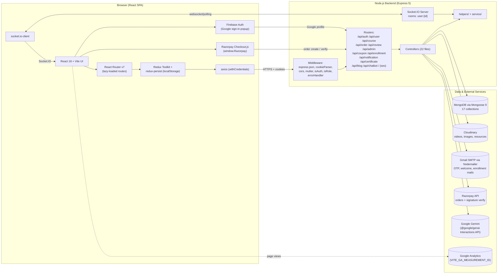
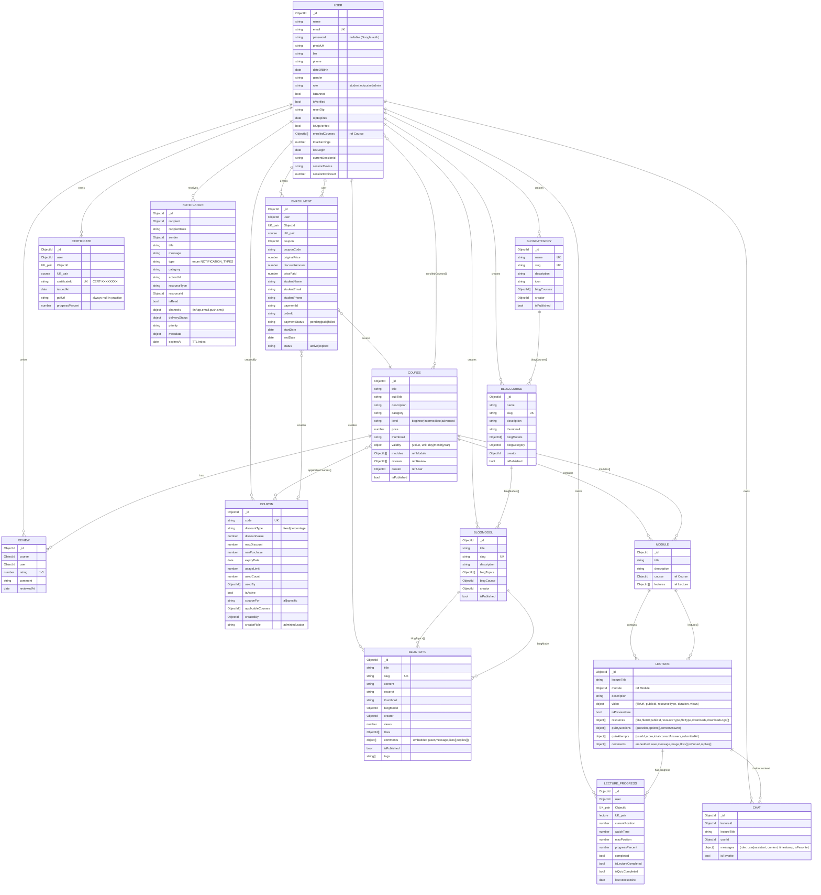

# SkillBridge LMS — Complete System Workflow

> **Document type:** Reverse-engineered technical documentation
> **Source:** `backend/` (Node.js/Express/MongoDB) and `frontend/` (React/Vite/Redux)
> **Method:** Every workflow below was traced from real source code. File paths and function names are given for each step. Anything that is dead code, unwired, or broken is explicitly marked **[BROKEN]**, **[DEAD CODE]**, or **[MISSING]**.

---

## Table of Contents

1. [Complete System Architecture](#1-complete-system-architecture)
2. [Application Startup Flow](#2-application-startup-flow)
3. [Frontend–Backend Communication](#3-frontendbackend-communication)
4. [Database Relationships & ER Diagram](#4-database-relationships--er-diagram)
5. [User Roles and Permissions](#5-user-roles-and-permissions)
6. [Registration and Login Workflow](#6-registration-and-login-workflow)
7. [JWT Authentication Workflow](#7-jwt-authentication-workflow)
8. [Course Creation and Publishing](#8-course-creation-and-publishing)
9. [Module and Lecture Creation](#9-module-and-lecture-creation)
10. [Student Course Browsing](#10-student-course-browsing)
11. [Course Purchase and Enrollment](#11-course-purchase-and-enrollment)
12. [Razorpay Payment Creation and Verification](#12-razorpay-payment-creation-and-verification)
13. [Coupon Application](#13-coupon-application)
14. [Lecture Video Upload](#14-lecture-video-upload)
15. [Cloudinary and HLS Processing](#15-cloudinary-and-hls-processing)
16. [Video Playback](#16-video-playback)
17. [Lecture Progress Tracking](#17-lecture-progress-tracking)
18. [Resume Learning Functionality](#18-resume-learning-functionality)
19. [Quiz Workflow](#19-quiz-workflow)
20. [Certificate Generation](#20-certificate-generation)
21. [Comments and Reviews](#21-comments-and-reviews)
22. [Notifications, Email and Socket.IO](#22-notifications-email-and-socketio)
23. [AI Chatbot Workflow](#23-ai-chatbot-workflow)
24. [Blog Creation and Publishing](#24-blog-creation-and-publishing)
25. [Search and SEO Workflow](#25-search-and-seo-workflow)
26. [Other Workflows Discovered in the Code](#26-other-workflows-discovered-in-the-code)
27. [Broken / Missing / Dead Integrations Summary](#27-broken--missing--dead-integrations-summary)
28. [Complete Frontend–Backend API Integration Table](#28-complete-frontendbackend-api-integration-table)

---

## 1. Complete System Architecture

SkillBridge LMS is a classic **MERN** application with a few extras (Razorpay, Cloudinary, Socket.IO, Google Gemini AI, Firebase Google Sign-In).



**Key architectural facts (verified in code):**

- Backend entry point: `backend/index.js` creates an `http.Server`, attaches Socket.IO via `initializeSocketServer` (`backend/sockets/index.js`), then `server.listen()` → `connectDb()` (`backend/config/connectDB.js` → `mongoose.connect(process.env.MONGODB_URI)`).
- Express app: `backend/app.js`. JSON body parser, `cookieParser`, CORS allow-list `[FRONTEND_URL, http://localhost:5173, https://skillbridgelearnbyrishi.vercel.app]` with `credentials: true`.
- **There is no centralized axios instance on the frontend.** Every slice/page calls `axios` directly with `BASE_URL = import.meta.env.VITE_SERVER_URL` and `{ withCredentials: true }`. The only exception is `frontend/src/redux/slices/adminSlice.js`, which creates `axios.create({ baseURL: BASE_URL + "/api/admin" })`.
- Auth is **cookie-based**: JWT stored in an `httpOnly` cookie named `token`, plus the same token returned in the JSON body (used by Socket.IO `withCredentials` and stored client-side via `setUserData` in Redux).
- Frontend state: Redux Toolkit store (`frontend/src/redux/slices/store.js`) persisted to `localStorage` via `redux-persist`. On every app load, `App.jsx` dispatches `fetchCurrentUser()` then clears `progress` and `module` slices to prevent cross-user leakage.
- Role enforcement exists **only on the backend** (`isAuth` + `isRole` middleware). Frontend route guards in `App.jsx` are UX-only (`userData?.role === "educator"` etc.).

---

## 2. Application Startup Flow

### Backend startup (`backend/index.js`)

1. `dotenv.config()` loads env vars.
2. `http.createServer(app)` wraps the Express app.
3. `initializeSocketServer(server)` (`backend/sockets/index.js`) attaches Socket.IO with the same CORS origins; on `connection` it logs the socket and listens for a `"join"` event → `socket.join(\`user:${userId}\`)`.
4. `initializeSocket(io)` (`backend/service/socketNotificationService.js`) stores the `io` instance in a module-level variable so services can emit later.
5. `server.listen(port)` → on success:
   - `await connectDb()` → `mongoose.connect(process.env.MONGODB_URI)`.
   - `await deleteOldNotifications()` — deletes `Notification` docs older than 15 days (`backend/service/notificationService.js`).
   - `setInterval(deleteOldNotifications, 24h)` — daily cleanup.
6. `app.js` preloads Mongoose schemas by importing model files (ensures `ref` targets like `Module`, `Lecture`, `BlogCategory`… are registered before population).

### Frontend startup (`frontend/src/main.jsx`)

1. `createRoot` renders `<StrictMode><HelmetProvider><BrowserRouter><Provider store={store}><ThemeProvider><PersistGate persistor={persistor}><GoogleAnalytics/><App/></PersistGate>`.
2. In production only, registers `/sw.js` service worker.
3. `App.jsx` mounts `<SocketProvider>` (connects Socket.IO only when `userData?._id` exists), `<SEO>` (react-helmet-async), `<ToastContainer>`, `<ScrollToTop>`, then lazy-loaded `<Routes>`.
4. First `useEffect`: `dispatch(fetchCurrentUser())` → `GET /api/user/getcurrentuser`; `clearAllProgress()`; `clearModuleData()`; deferred `fetchAllReviews()`.
5. Second `useEffect` keyed on `userData`: dispatches role-specific fetches — everyone gets `fetchPublishedCourses()`; educators get `fetchCreatorCourses()`; admins get `fetchAllUsers()`, `fetchCourses()`, `fetchPlatformStats()`.

---

## 3. Frontend–Backend Communication

| Aspect | Actual implementation |
|---|---|
| Protocol | HTTPS REST (Express 5) + Socket.IO (WebSocket with polling fallback) |
| Auth transport | `httpOnly` cookie `token` (SameSite=Lax dev / None+Secure prod, 7-day maxAge) **and** `Authorization: Bearer <token>` accepted by `isAuth` |
| CORS | Explicit origin allow-list, `credentials: true` |
| Request style | Raw `axios` calls inside `createAsyncThunk` thunks or directly in components; `withCredentials: true` everywhere |
| File upload | `multipart/form-data` via `FormData` → backend `multer` disk storage (`uploads/`) → uploaded to Cloudinary → local file deleted |
| Real-time | Socket.IO client connects to `VITE_SERVER_URL`, emits `"join"` with user id, listens for `"new-notification"` and `"unread-count"` |
| Payments | Razorpay Checkout.js opened client-side with `key: VITE_RAZORPAY_KEY_ID`; signature verified server-side |
| AI | `POST /api/chatbot/chat` → Google Gemini (`@google/genai`, model `gemini-3.6-flash`, Interactions API) |
| Email | Nodemailer Gmail SMTP (`USER_EMAIL`/`USER_PASSWORD`), OTP + welcome + enrollment + admin-new-user templates in `backend/config/sendMail.js` |

---

## 4. Database Relationships & ER Diagram

All schemas live in `backend/models/`. Relationships are stored as **arrays of ObjectId refs** (denormalized parent→child links) plus **back-references** on the child (`course`, `module`, `lecture`, `blogModel`…). Several heavy structures are **embedded subdocuments** (comments, quiz questions/attempts, resources, video inside `Lecture`; comments/replies inside `BlogTopic`).



**Indexes worth noting:**
- `Enrollment`: unique compound `{user:1, course:1}` — prevents duplicate enrollments at DB level.
- `LectureProgress`: unique `{user:1, lecture:1}`.
- `Certificate`: unique `{user:1, course:1}` and unique `certificateId`.
- `Notification`: TTL index on `expiresAt` (`expireAfterSeconds: 0`) plus query indexes.
- `User.email` unique; `Coupon.code` unique; blog slugs unique.

---

## 5. User Roles and Permissions

Defined in `userModel.js` (`role` enum) and enforced by `backend/middleware/isRole.js` (variadic role check against `req.user.role` set by `isAuth`).

| Role | Can do | Enforced by |
|---|---|---|
| `student` (default) | Browse published courses, buy/enroll, watch lectures (if enrolled & course active), progress, quiz, comments, reviews, certificates, notifications, chatbot, blogs read/comment/like | Any authenticated route without `isRole`, or `isRole` lists that include `"student"` (rarely used) |
| `educator` | Everything a student can + create/edit/delete **own** courses, modules, lectures, quiz questions, resources, coupons (for own courses), blog categories/courses/models/topics, view own dashboard stats & recent enrollments | `isRole("educator")` on course/module/lecture/resource/quiz/blog-create routes; `isRole("educator")` on coupon routes; **ownership is NOT checked** on course edit/delete/publish — any educator can modify any course **[SECURITY NOTE]** |
| `admin` | All educator powers + user management (list/ban/unban/delete/role-change), all-courses list, platform stats, all coupons, publish toggle for any course | `isRole("admin")` on `/api/admin/*` and `/api/course/all-courses` |

**Important actual behaviors:**
- `signUP` accepts a client-supplied `role` (`role || "student"`) — **anyone can self-register as `educator` or `admin`** `[SECURITY NOTE]`.
- `changeUserRole` only allows `"student"`/`"educator"` — admins cannot be created via API; the only admin is seeded by `backend/config/createAdmin.js` (which has a broken import path `./models/userModel.js` — it lives in `config/`, so the file would crash if run; **[BROKEN]** but harmless since it's a standalone script).
- Banned users: `isAuth` returns 403 `"Account banned"` on every request; login also blocks with 403.
- `isAuth` (`backend/middleware/isAuth.js`) does: cookie→Bearer token extraction → `jwt.verify(token, JWT_SECRET)` → `User.findById(decoded.userId).select("_id role isBanned currentSessionId sessionExpiresAt")` → banned check → **session expiry check** (`sessionExpiresAt < Date.now()` → clears session fields, returns 401 `sessionExpired: true`) → sets `req.user = {_id, role}` and `req.userId`.

---

## 6. Registration and Login Workflow

### 6.1 Email/Password Signup — `POST /api/auth/signup` → `signUP` (`backend/controller/authController.js`)

**Frontend:** `frontend/src/pages/auth/SignUp.jsx` → `axios.post(BASE_URL + "/api/auth/signup", {name,email,password,role,confirmPassword})` → `dispatch(setUserData(user))` → navigate by role.

**Backend steps:**
1. Validate presence, `validator.isEmail`, password ≥ 8 chars.
2. `User.findOne({email})` → 400 if exists.
3. `bcrypt.hash(password, 10)`.
4. `User.create({name,email,password:hash,role:role||"student",isVerified:true})` — **no email OTP on signup; `isVerified` defaults true** (OTP flow exists only for password reset).
5. Generate JWT (`genToken`, 7d), random `currentSessionId` (32-byte hex), `sessionExpiresAt = now + 7d`, `sessionDevice = user-agent[:100]`, `lastLogin`.
6. `res.cookie("token", token, {httpOnly, secure: prod, sameSite: prod?"None":"Lax", maxAge: 7d})`.
7. Respond `201 {success, message, user (safe, -password), token, sessionId}`.

**Note:** Unlike login, signup does **not** call `notifyNewUserRegistration` — the helper exists (`backend/helpers/notificationHelpers.js`) but is never invoked anywhere **[MISSING wiring]**.

### 6.2 Login — `POST /api/auth/login` → `login`

**Frontend:** `frontend/src/pages/auth/Login.jsx` → `axios.post(.../api/auth/login, {email,password})` → `setUserData` → role-based redirect (`/admin/dashboard`, `/educator/dashboard`, `/student/dashboard`).

**Backend steps:**
1. `User.findOne({email})` → 404.
2. Auto-heals legacy `isVerified:false` → true.
3. `isBanned` → 403.
4. `bcrypt.compare` → 400 "Incorrect password".
5. Same session+JWT+cookie block as signup; updates `currentSessionId` — **this overwrites the previous session id, effectively enforcing single-device login** (the old token still verifies JWT-wise but its `currentSessionId` no longer matches… actually `isAuth` only checks `sessionExpiresAt`, not that the JWT carries the session id — see JWT section for the real behavior).
6. `200 {success, user, token, sessionId}`.

### 6.3 Google Sign-In — `POST /api/auth/googleauth` → `googleAuth`

**Frontend:** `SignUp.jsx`/`Login.jsx` call `signInWithPopup(auth, provider)` from `frontend/src/utils/firebase.js` (Firebase project `skillbridge-87e1f`), then POST `{name,email,photoUrl,role}` to `/api/auth/googleauth`.

**Backend:** find-or-create user by email (`password` stays `null`, `isVerified:true`, `photoUrl` backfilled if missing), then identical session/JWT/cookie issuance. Responds `201 {user, token, sessionId}` — **note: `user` here is the full Mongoose doc including `password:null` (harmless) but also OTP/session fields**.

### 6.4 Logout — `GET /api/auth/logout` → `logOut`

**Frontend:** `Navbar.jsx`, `AdminSidebar.jsx`, `MobileSidebar.jsx`, `studentDashboard/Sidebar.jsx` call `axios.get(BASE_URL + "/api/auth/logout")` then `dispatch(clearUserData())` (or equivalent) and redirect.

**Backend:** ⚠️ `logOut` reads `req.user` but the route has **no `isAuth` middleware** (`authRoute.js` mounts it bare), so `req.user` is always undefined — the session-clearing block is skipped; only `res.clearCookie("token")` + `200 {message:"Logout successful"}` actually runs. The user's `currentSessionId`/`sessionExpiresAt` remain set in DB **[MINOR BUG: server-side session not cleared on logout]**.

### 6.5 Password Reset (OTP) — three endpoints

| Step | Endpoint | Controller | What happens |
|---|---|---|---|
| 1 | `POST /api/auth/sendotp` | `sendOtp` | 6-digit OTP → `user.resetOtp`, `otpExpires = now+5min`, `isOtpVerifed=false` → `sendMail(email, otp)` (Gmail HTML template) |
| 2 | `POST /api/auth/verifyotp` | `varifyOTP` | Checks `resetOtp`, expiry → sets `isOtpVerifed=true`, clears OTP fields |
| 3 | `POST /api/auth/resetpassword` | `resetPassword` | Requires `isOtpVerifed` → `bcrypt.hash` new password, resets flag |

**Frontend:** `frontend/src/pages/auth/ForgetPassword.jsx` calls all three in sequence.

### 6.6 Clear Session — `POST /api/auth/clearsession` → `clearSession`

Escape hatch for users stuck with stale sessions: body `{email}` → nulls session fields → `200`. **Unauthenticated** (no `isAuth`), so anyone can clear anyone's session by email **[SECURITY NOTE]**.

---

## 7. JWT Authentication Workflow

```mermaid
sequenceDiagram
    participant FE as Frontend (axios)
    participant MW as isAuth middleware
    participant JWT as jsonwebtoken
    participant DB as MongoDB (users)

    FE->>MW: Request + Cookie: token=JWT (or Authorization: Bearer)
    MW->>MW: token = req.cookies.token || Bearer header
    alt No token
        MW-->>FE: 401 {success:false, message:"Access denied"}
    end
    MW->>JWT: jwt.verify(token, JWT_SECRET)
    alt Invalid/expired
        MW-->>FE: 401 "Invalid token" / "Token expired"
    end
    JWT-->>MW: decoded {userId, iat, exp}
    MW->>DB: User.findById(userId).select("_id role isBanned currentSessionId sessionExpiresAt")
    alt User missing
        MW-->>FE: 404 "User not found"
    else isBanned
        MW-->>FE: 403 "Account banned"
    else sessionExpiresAt < now
        MW->>DB: clear session fields
        MW-->>FE: 401 {sessionExpired:true, message:"Session expired. Please login again."}
    else OK
        MW->>MW: req.user={_id,role}; req.userId=user._id
        MW->>FE: next() → controller runs
    end
```

**Facts:**
- Token payload: `{userId}` only, signed with `process.env.JWT_SECRET`, `expiresIn:"7d"` (`backend/config/token.js` → `genToken`).
- Cookie and body both carry the token; frontend stores user object (not token) via `setUserData` in `userSlice`.
- `isRole(...roles)` runs after `isAuth` on protected admin/educator routes; returns 401 if `!req.user`, 403 if role not in list.
- Session model: `currentSessionId` (random hex), `sessionDevice` (user-agent), `sessionExpiresAt` (7 days). **The JWT does not embed the session id**, so `isAuth` cannot detect "logged in elsewhere" — it only enforces the 7-day expiry. Single-device enforcement is therefore partial **[ACTUAL BEHAVIOR]**.
- On 401 the frontend typically toasts "Session expired" and routes to `/login` (e.g., `CheckoutPage.jsx` handles `error.response?.status === 401`).

---

## 8. Course Creation and Publishing

### 8.1 Create — `POST /api/course/create` (educator)

**Frontend:** `pages/educator/CreateCourse.jsx` → thunk `createCourse` in `frontend/src/redux/actions/courseAction.js` → `axios.post(.../api/course/create, courseData)` → toast → `navigate("/educator/courses")` → `dispatch(fetchCreatorCourses())`.

**Backend:** `courseRoute.js` → `isAuth` → `isRole("educator")` → `createCourse` (`courseController.js`):
1. Requires `title`, `category`; `validity` defaults `{value:6, unit:"month"}`.
2. `Course.create({title,category,description,validity,creator:req.userId})` — `isPublished` defaults **false**, `price` defaults **0** (free).
3. **Notification fan-out:** `User.find({role:"student"})` then `createNotification(...)` **per student** (type `announcement`, actionUrl `/course/:id`) — O(N) inserts + N socket emits; wrapped in try/catch so failure doesn't break creation.
4. `201 {success, message, course}`.

### 8.2 Edit — `PUT /api/course/editcourse/:courseId` (educator, `upload.single("thumbnail")`)

`editCourse`: builds `updateData` from provided fields, `price` → Number, `validity.value/unit` → nested object, `isPublished === "true"` boolean coercion; if `req.file` → `uploadOnCloudinary(req.file.path)` → `thumbnail = fileUrl`; `Course.findByIdAndUpdate(..., {new:true})`.

### 8.3 Publish / Unpublish — two routes, one controller

- `PUT /api/course/publish/:courseId` and `PUT /api/course/unpublish/:courseId` → both call `togglePublishCourse` (educator). Also `PUT /api/admin/course/publish/:courseId` → `adminController.toggleCoursePublish` (admin, **no student notifications** — inconsistency vs educator path).
- `togglePublishCourse`: flips `isPublished`, saves; **when publishing**, loops all students → `createNotification` ("🚀 New Course Launched!") — again N inserts.
- Admin `ManageCourses.jsx` uses `/api/admin/*`; educator `Courses.jsx` uses thunk `togglePublish` → `/api/course/publish/:id`.

### 8.4 Read paths

| Endpoint | Controller | Behavior |
|---|---|---|
| `GET /api/course/getpublished` | `getPublishedCourses` | `Course.find({isPublished:true})` populated `modules→lectures`, `creator{name,email,photoUrl,role}`, `reviews`; merges per-user `LectureProgress` into each lecture when `req.userId` present (note: route has **no `isAuth`**, so `req.userId` is always undefined → progress merge is dead code here) |
| `GET /api/course/getcourse/:courseId` | `getCourseById` | Same populate chain; also no `isAuth` → progress merge never runs |
| `GET /api/course/getcreator` | `getCreatorCourses` | `isAuth`+educator; courses where `creator=req.userId` |
| `GET /api/course/all-courses` | `getAllCourses` | admin only |
| `POST /api/course/creator` | `getCreatorById` | body `{userId}` → public-ish user profile (auth required) |
| `GET /api/course/user-enrollments` | `getUserEnrollments` (enrollment controller) | see §11 |
| `GET /api/course/recent-enrollments` | `getRecentEnrollments` (dashboard controller) | educator's last 10 enrollments |
| `GET /api/course/dashboard-stats` | `getDashboardStats` | educator analytics (courses, unique students, earnings, avg progress, downloads, per-course enrollment) |

**Frontend consumers:** `courseSlice.fetchPublishedCourses` (App load + student pages), `fetchCreatorCourses` (educator), `fetchCourseById` (`selectedCourse` used by `CourseDetail`, `CheckoutPage`, `ViewCourse`).

---

## 9. Module and Lecture Creation

### 9.1 Modules — `POST /api/course/create-module/:courseId` (educator)

**Frontend:** `pages/educator/Module.jsx` → `createModule` thunk (`moduleSlice.js`) → `POST .../create-module/:courseId {title,description}` → `fetchModules(courseId)` refresh.

**Backend:** `createModule` (`moduleController.js`): validate title → `Course.findById` → `Module.create({title,description,course:courseId})` → `course.modules.push(module._id)` → `course.save()` → `201`.

Other module endpoints: `GET /api/course/course-modules/:courseId` (`getCourseModules` — populates modules→lectures, merges user progress if `req.userId`, returns `totalModules/totalLectures/totalDuration` + per-module stats), `DELETE /api/course/remove-module/:moduleId` (cascade-deletes its lectures then `$pull`s from course), `DELETE /api/course/remove-all-modules/:courseId`.

**Broken:** `moduleSlice.updateModule` calls `PUT /api/course/update-module/:moduleId` — **no such route exists** **[BROKEN — thunk will 404]**.

### 9.2 Lectures — `POST /api/course/createlecture/:moduleId` (educator)

**Frontend:** `pages/educator/CreateLecture.jsx` → `createLecture` thunk (`lectureSlice.js`) with `{lectureTitle, description}` only — **video is NOT uploaded at creation**; it's added later via Edit Lecture.

**Backend:** `createLecture` (`lectureController.js`): requires title+description → `Module.findById` → `Lecture.create({lectureTitle,description,module:moduleId})` → `module.lectures.push(lecture._id)` → `module.save()`.

Other lecture endpoints: `GET /api/course/courselecture/:moduleId` (educator; populate lectures + progress merge), `POST /api/course/editlecture/:lectureId` (multipart `videoUrl` file + fields — see §14), `DELETE /api/course/removelecture/:lectureId` (destroys Cloudinary video + all resources, deletes doc, `$pull`s from course.lectures — note: course has no `lectures` array anymore, harmless no-op), `DELETE /api/course/remove-lecture-video/:lectureId`, `PUT /api/course/mark-lecture-completed/:lectureId`, `PUT /api/course/mark-quiz-completed/:lectureId`.

---

## 10. Student Course Browsing

**Frontend flow:**
- `App.jsx` → `fetchPublishedCourses` → `state.course.courseData`.
- Home page sections (`components/home/sections/FeaturedCourses.jsx`, `CourseCategories.jsx`…) render `CourseCard` from `courseData`.
- `pages/student/AllCourses.jsx` (`/allcourses`, auth-required) lists all published courses with client-side filtering (category/level/search text — **filtering is client-side; there is no search API**, see §25).
- `pages/student/CourseDetail.jsx` (`/course/:courseId`, auth-required): on mount calls `checkEnrollment()` → `GET /api/enrollment/check/:courseId`; reads `selectedCourse` (fetched via `fetchCourseById`) for title/price/description/creator; shows "Days Remaining" from enrollment data; enroll button branches: free → `handleFreeEnroll` → `POST /api/course/enroll/:courseId` (note: this hits the **course router's** enroll path? Actually it posts to `/api/course/enroll/${courseId}` — **no such route exists** on courseRoute; the real free-enroll route is `POST /api/enrollment/enroll/:courseId`. **[BROKEN endpoint in CourseDetail.jsx — free enroll from this page 404s]**); paid → navigates to `/checkout/:courseId`.
- Navbar `CoursesMegaMenu`/`CourseGrid` use published courses + `categories.js` for mega-menu.

---

## 11. Course Purchase and Enrollment

Two distinct paths exist:

### 11.1 Free course — `POST /api/enrollment/enroll/:courseId` → `enrollCourse`

**Frontend:** `enrollmentSlice.enrollFreeCourse` thunk → used by `CourseDetail`/`MyEnrolledCourses` flows (and `checkEnrollmentStatus` thunk → `GET /api/enrollment/check/:courseId`).

**Backend (`enrollMentController.js`):**
1. `User.findById`, `Course.findById` → 404.
2. `course.price > 0` → 400 "Paid course requires payment".
3. Lazy-expire: `Enrollment.updateMany({user,course,endDate<=now,status:"active"} → status:"expired")`.
4. Active enrollment check → 400 "Already enrolled".
5. `calculateEnrollmentEndDate(course.validity)` (`helpers/enrollmentHelpers.js`) → `{startDate: now, endDate: now+value unit}`.
6. `createEnrollment` → `Enrollment.create({user,course,pricePaid:0,startDate,endDate,status:"active"})` + `User.findByIdAndUpdate($addToSet enrolledCourses)`.
7. `sendEnrollmentNotifications` → `notifyCourseEnrollmentToCreatorAndAdmin` (educator + all admins via `createBulkNotifications` → `Notification.insertMany` — **note: bulk path does NOT socket-emit**) + `sendEnrollmentConfirmationEmail` to student (Gmail).
8. `201 {success, message, enrollment}`.

### 11.2 Paid course — Razorpay (§12) then enrollment inside `VerifyPayment`.

### 11.3 Enrollment reads & expiry model

- `GET /api/enrollment/user` → `getUserEnrollments`: runs `updateExpiredEnrollments(userId)` (marks expired + `$pull`s course from `user.enrolledCourses`), returns enrollments populated `course{title,thumbnail,price,category,level,creator}` + `course.creator{name,photoUrl}`, each annotated `{isExpired,isActive,status,daysRemaining}`.
- `GET /api/enrollment/check/:courseId` → `checkEnrollmentStatus`: returns `{isEnrolled,isActive,status:"not_enrolled"|"active"|"expired",daysRemaining,...}`; lazily expires on read.
- `GET /api/course/user-enrollments` → same `getUserEnrollments` controller mounted twice (course router + enrollment router) — duplicate surface.
- `utils/isCourseActive.js` `isCourseActive(userId,courseId)` — helper implementing the same lazy-expiry logic; **grep shows it is not imported by any controller** **[DEAD CODE]** (expiry logic is duplicated inline instead).
- `helpers/enrollmentHelpers.js` also exports `calculateDaysRemaining` — used; `createEnrollment` — used by free enroll only (paid path uses `findOneAndUpdate` upsert instead).

**Frontend:** `enrollmentSlice` (`fetchUserEnrollments`, `checkEnrollmentStatus`, `enrollFreeCourse`), `pages/student/MyEnrolledCourses.jsx` (`/mycourses` and `/student/my-courses`) fetches `/api/course/user-enrollments` directly with axios, shows status chips + days remaining.

---

## 12. Razorpay Payment Creation and Verification

**Frontend:** `pages/student/CheckoutPage.jsx` (`/checkout/:courseId`) — the main checkout; `pages/educator/ViewCourse.jsx` has a second, simpler payment path for its own preview page.

### 12.1 Create order — `POST /api/order/razorpay-order` → `RazorPayOrder` (`orderController.js`)

**CheckoutPage flow:**
1. Form `{name,email,phone}` auto-filled from `userData`; coupon state `{coupon,discount,appliedCouponId}`.
2. `applyCoupon()` → `POST /api/coupon/apply {code,courseId}` → sets `discount` (§13).
3. `handlePayment()` → validates form + login → `axios.post(.../razorpay-order, {courseId, couponCode, discount})`.
4. Opens `new window.Razorpay({key: VITE_RAZORPAY_KEY_ID, amount: order.amount, currency:"INR", name:"LEARN SKILLS", order_id: order.id, handler: ...})`.

**Backend `RazorPayOrder`:** `Course.findById` → `finalPrice = max(course.price - (discount||0), 0)` → `RazorPayInstance.orders.create({amount: finalPrice*100, currency:"INR", receipt: rcpt_<id>_<ts>})` → `200 {success, order}`. **The discount is trusted from the client** — server does not re-validate the coupon here **[SECURITY NOTE: price tampering possible]**.

### 12.2 Verify + enroll — `POST /api/order/verifypayment` → `VerifyPayment`

Razorpay `handler` posts `{...response (razorpay_order_id, razorpay_payment_id, razorpay_signature), courseId, name, email, phone, originalPrice, discountAmount, couponId, couponCode}`.

**Backend steps:**
1. **Signature check:** `HMAC_SHA256(order_id + "|" + payment_id, RAZORPAY_KEY_SECRET)` hex === `razorpay_signature` → else 400 "Invalid payment signature".
2. Load `User` + `Course` → 404.
3. Duplicate check: active non-expired `Enrollment` → 400 "Already enrolled".
4. `calculateEnrollmentEndDate(course.validity)`.
5. `Enrollment.findOneAndUpdate({user,course}, {$set:{status:"active", pricePaid: course.price-(discountAmount||0), startDate,endDate, paymentStatus:"paid", paymentId, orderId, originalPrice, discountAmount, studentName/Email/Phone (fallback to user), coupon, couponCode}}, {upsert:true,new:true,setDefaultsOnInsert:true})` — upsert revives expired enrollments.
6. `User.findByIdAndUpdate($addToSet enrolledCourses)`.
7. `User.findByIdAndUpdate(course.creator, {$inc:{totalEarnings: amountPaid}})`.
8. If `couponId` → `Coupon.findByIdAndUpdate($inc usedCount, $addToSet usedBy)`.
9. `sendEnrollmentNotifications` → educator+admin in-app notifications (bulk, **no socket emit**) + student confirmation email.
10. `200 {success, message:"Payment verified & enrollment successful", enrollment}` → frontend `toast.success` → `navigate(/viewlecture/:courseId)`.

**Error scenarios:** invalid signature 400; missing user/course 404; duplicate 400; Razorpay order failure 500; coupon over-use is **not** rechecked at verify time **[note]**.

---

## 13. Coupon Application

**Admin/Educator management:** `coupon.routes.js` — `POST /api/coupon/create`, `GET /all` (admin), `GET /my-coupons` (educator), `GET /:id`, `PUT /update/:id`, `DELETE /delete/:id`, `PATCH /toggle/:id` (all `isAuth`+role; educator ownership checked on update/delete/toggle and on `couponFor:"specific"` creation). Frontend: `couponSlice.js` thunks + `pages/admin/Coupons.jsx` (admin) and educator `/educator/coupons` (same component).

**Apply — `POST /api/coupon/apply` → `applyCoupon` (any authenticated user):**
1. `Course.findById(courseId)` → 404.
2. `Coupon.findOne({code: code.toUpperCase(), isActive:true})` → 404 "Invalid coupon".
3. Expired → 400; `usedCount >= usageLimit` → 400.
4. `couponFor==="specific"` → course must be in `applicableCourses`.
5. `originalPrice < minPurchase` → 400.
6. Discount: `fixed` → `discountValue`; `percentage` → `price*value/100` capped by `maxDiscount`; clamped to `originalPrice`.
7. `200 {success, couponId, couponCode, originalPrice, discount, finalPrice}` → CheckoutPage stores `discount`+`appliedCouponId`; `couponSlice.setCouponPricing` exists but CheckoutPage uses local state.

**Actual behavior vs recommended:** discount is computed server-side for display, but the **paid amount is recomputed client-side-trusting** in `RazorPayOrder` (`course.price - discount`) and `VerifyPayment` (`course.price - discountAmount`) — a modified client could pay ₹0 for a paid course **[SECURITY GAP]**.

---

## 14. Lecture Video Upload

**Frontend:** `pages/educator/EditLecture.jsx` (`/educator/editlecture/:courseId/:moduleId/:lectureId`) — the **only** place videos are attached:
1. `FormData` with fields + `formData.append("videoUrl", videoFile)` (field name is `videoUrl`, mime video/*).
2. `axios.post(.../api/course/editlecture/${lectureId}, formData)` — note `lectureSlice.updateLecture` posts **without** FormData headers/file (used for metadata-only edits → `req.file` absent → text fields only update).
3. Delete video: `axios.delete(.../api/course/remove-lecture-video/${lectureId})`.

**Backend:** `editLecture` (`lectureController.js`) with `upload.single("videoUrl")` (multer, 500MB limit):
1. `Lecture.findById` → 404.
2. If `req.file`: destroy old `lecture.video.publicId` on Cloudinary (`resource_type` from stored value) → `uploadOnCloudinary(req.file.path)` → save `{fileUrl, publicId, resourceType, duration}` to `lecture.video`.
3. Update `lectureTitle`, `description`, `isPreviewFree` (`"true"|true` coercion) → `lecture.save()`.

`createLecture` does **not** accept files (no multer on that route) — video-less lectures are valid.

---

## 15. Cloudinary and HLS Processing

**Upload helper:** `backend/config/cloudinary.js` → `uploadOnCloudinary(filePath)`:
- `cloudinary.config({cloud_name: CLOUDINARY_NAME, api_key, api_secret})`.
- Extension check: `.pdf` → `resource_type:"raw"`, folder `lecture-resources`; `.m3u8` → `resource_type:"video"`, folder `lecture-videos`; everything else → `resource_type:"auto"`, folder `lecture-resources` (videos land here as `auto`→video).
- `cloudinary.uploader.upload(filePath, {resource_type, folder, chunk_size:6MB})` → deletes local `uploads/` file (also on error) → returns `{fileUrl: secure_url, publicId, resourceType, duration}`.

**HLS — ACTUAL STATUS: NOT IMPLEMENTED in the request path.**
- `backend/utils/convertToHLS.js` exists (fluent-ffmpeg + ffmpeg-static → `.m3u8` + `segment_%03d.ts`, 10s segments) **but is never imported or called anywhere** **[DEAD CODE]**.
- No route triggers transcoding; videos are stored as single MP4 files on Cloudinary.
- Frontend has `hls.js` in `package.json` but **no source file imports it**; players use a plain `<video src={fileUrl}>` tag. Cloudinary's `auto` resource type may still deliver adaptive streaming via URL params, but the app does not request `.m3u8` explicitly **[ACTUAL: progressive MP4 playback]**.

**Other Cloudinary uses:** course thumbnails (`editCourse`), blog topic thumbnails (`editBlogTopic`), user avatars (`updateProfile`), lecture resources (`uploadLectureResource`), deletions via `cloudinary.uploader.destroy(publicId, {resource_type, invalidate:true})` in `removeLecture`, `removeLectureVideo`, `removeResource`.

---

## 16. Video Playback

**Frontend components:**
- `components/lecture/LecturePlayer.jsx` — main player inside lecture view: sets `video.src = lecture.video.fileUrl`, restores `lecture.currentPosition`, listens `timeupdate/play/pause/ended`, throttles `POST /api/course/progress/update`, calls `PUT /api/course/mark-lecture-completed/:id` at end; tabs for resources/comments/quiz/chatbot.
- `components/progress/VideoPlayer.jsx` — simpler `<video>` player used by progress views; sets `src` + `resumePosition`.

**Access control actual behavior:** lecture/video URLs are embedded in course payloads returned by `getpublished`/`getcourse`/`course-modules` **without enrollment checks** — `isPreviewFree` exists on the schema and `CourseDetail`/`ViewLecture` gate UI navigation, but the Cloudinary `fileUrl` is technically exposed in API responses to any authenticated user **[SECURITY NOTE: no signed URLs / no server-side enrollment gate on video fetch]**.

---

## 17. Lecture Progress Tracking

**Frontend:** `LecturePlayer.jsx` posts on `timeupdate` (throttled ~every few seconds) and on pause/ended; `progressSlice.updateProgress` thunk → `POST /api/course/progress/update {lectureId, currentPosition}`.

**Backend:** `updateLectureProgress` (`progressController.js`):
1. `Lecture.findById` → 404.
2. `LectureProgress.findOne({user,lecture})` or `new LectureProgress`.
3. Sets `currentPosition`, `maxPosition = max(old, current)`, `watchTime = maxPosition` (actual watch-time accumulation is **not** computed — it mirrors maxPosition **[ACTUAL QUIRK]**), `lastAccessedAt`.
4. `progressPercent = min(100, round(maxPosition / lecture.video.duration * 100))` (0 if no duration).
5. **Auto-complete at ≥95%** → `completed=true, completedAt`.
6. `progress.save()` → `200 {success, progress}`.

Related: `PUT /api/course/mark-lecture-completed/:lectureId` → `markLectureCompleted` sets `isLectureCompleted/lectureCompletedAt`; `PUT /api/course/mark-quiz-completed/:lectureId` similarly for quiz.

**Merge into course payloads:** `mergeUserProgressWithLectures`/`mergeUserProgressWithModules` (`progressController.js`, exported and reused by `courseController`/`moduleController`) batch-fetch `LectureProgress` for `{user, lecture:{$in:ids}}` and attach `isLectureCompleted, isQuizCompleted, currentPosition, progressPercent, completed` to each lecture object.

---

## 18. Resume Learning Functionality

- **Per-lecture resume:** `LecturePlayer` reads `lecture.currentPosition` (merged progress) → `video.currentTime = currentPosition` on load.
- **Per-course resume:** `GET /api/course/progress/resume/:courseId` → `resumeLecture`: finds course's modules→lectures, then `LectureProgress.findOne({user, lecture:{$in:ids}}).populate("lecture").sort({lastAccessedAt:-1})` → returns `{lecture: fullLecture, currentPosition}` (or `{lecture:null,currentPosition:0}`).
  - **Frontend:** `progressSlice.fetchResumeLecture`; `components/progress/ResumeLearningButton.jsx` and `pages/student/ViewLecture.jsx` consume it (ViewLecture also refetches `/api/course/progress/course/:courseId` every 30s while watching).
- **Course progress:** `GET /api/course/progress/course/:courseId` → `getCourseProgress`: counts completed lectures (`completed:true`), computes `progressPercent = round(completed/total*100)`, `totalCourseDuration`, and a `lectureProgress` map — consumed by `CourseLearning`/progress UI.

---

## 19. Quiz Workflow

**Educator side:**
- `POST /api/course/add-quiz/:lectureId` → `addQuizQuestion` (`quizController.js`): pushes `{question, options(≥2), correctAnswer}` into `lecture.quizQuestions` (embedded array).
- `DELETE /api/course/remove-quiz/:lectureId/:quizId` → `removeQuizQuestion` (`lecture.quizQuestions.pull`).
- `GET /api/course/get-quiz/:lectureId` → `getLectureQuiz` — **returns `quizQuestions` including `correctAnswer` to any authenticated user** **[SECURITY NOTE: answers exposed client-side]**.
- Frontend: `pages/educator/QuizUpload.jsx` (add/remove), questions embedded in lecture edit flows.

**Student side:**
- `components/lecture/QuizResult.jsx` renders `lecture.quizQuestions` (from the course payload — **answers included**), lets the user pick options, computes `score` **entirely client-side** (`quizQuestions.filter(q => answers[i] === q.correctAnswer)`), then `PUT /api/course/mark-quiz-completed/:lectureId` → sets `isQuizCompleted`.
- `lecture.quizAttempts` schema exists (`{userId,score,total,correctAnswers,submittedAt}`) **but no endpoint ever writes to it** — there is no quiz-submission API **[MISSING: server-side grading/attempt persistence]**.
- `ViewLecture.jsx` treats a lecture as fully complete only when `isLectureCompleted && (no quiz || isQuizCompleted)` before auto-advancing.

---

## 20. Certificate Generation

**Eligibility & creation:** `POST /api/course/certificate/generate/:courseId` (or `/api/certificate/generate/:courseId` — duplicate mount) → `generateCertificate` (`certificateController.js`):
1. `Course.findById` → modules → lectures → `lectureIds`.
2. Completed count = `max(LectureProgress.countDocuments({completed:true}), Lecture.countDocuments({isLectureCompleted:true}))` (the second query checks a field that doesn't exist on the Lecture schema — always 0; harmless).
3. `progressPercent < 70` → 400 with current %.
4. `Certificate.findOne({user,course})` else `Certificate.create({user,course,progressPercent, certificateId:"CERT-"+crypto.randomBytes(4).hex.toUpperCase()})`.
5. `200 {certificate}`.

**Frontend trigger:** `components/lecture/ModuleList.jsx` calls generate when course completes; `certificateSlice.generateCertificate` thunk also wraps the `/api/course/certificate/generate/` route; `progressSlice.setCertificateGenerated` tracks UI state.

**Read/download:**
- `GET /api/certificate/` → `getAllCertificates` (user's certs, populated course) — used by `pages/student/Certificates.jsx`.
- `GET /api/certificate/:courseId`, `GET /api/course/certificate/:courseId` → `getCertificate`.
- `GET /api/certificate/download/:courseId` (and `/api/course/certificate/download/:courseId`) → `downloadCertificate`: **generates the PDF on the fly with PDFKit** — A4 landscape, gold border, "Certificate of Completion", student name, course title, `CERT-XXXX` id, issue date, signature lines, seal; streams `application/pdf` with CORS headers for the download. `certificate.pdfUrl` field exists but is never populated **[stored cert = metadata only; PDF is ephemeral]**.
- `utils/generateCertificatePdf.js` (frontend, jspdf/html2canvas) exists as an alternative client-side generator.

---

## 21. Comments and Reviews

### 21.1 Lecture comments — embedded in `Lecture.comments[]`

All routes under `/api/course/comment/*` → `commentController.js`; frontend `commentSlice.js` + `components/lecture/*` comment UI.

| Action | Endpoint | Controller behavior |
|---|---|---|
| List | `GET /comment/:lectureId` | populate `comments.user{name,photoUrl,role}` + `replies.user`; pinned first, then newest |
| Add | `POST /comment/:lectureId` `{message}` | push `{user,message}` → returns populated new comment |
| Delete | `DELETE /comment/:lectureId/:commentId` | owner-only (`comment.user === req.userId`) |
| Reply | `POST /comment/reply/:lectureId/:commentId` | push into `comment.replies` |
| Delete reply | `DELETE /comment/reply/:lectureId/:commentId/:replyId` | owner-only |
| Like/unlike | `PUT /comment/like/:lectureId/:commentId` | toggle userId in `likes[]` → `{liked, likesCount}` |
| Reply like | `PUT /comment/reply/like/...` | same on reply |
| Pin | `PUT /comment/pin/:lectureId/:commentId` | `isAuth` only — **any user can pin** (route comment says "Educator Only" but no `isRole` is applied) **[SECURITY NOTE]**; unpins all others first |

Comment schema supports `image{fileUrl,publicId}` but **no endpoint accepts comment images** **[schema-only feature]**.

### 21.2 Course reviews — `Review` collection + `course.reviews[]`

- `POST /api/review/createreview` `{rating,comment,courseId}` → `createReview`: course exists, one-review-per-user check, `Review.save()`, `course.reviews.push(id)`. No enrollment check **[note]**.
- `GET /api/review/getreview` → `getReviews`: returns **all** reviews populated `user{name,photoUrl,description}` (field doesn't exist on User — harmless) + `course{title}` — no pagination/filter; frontend `reviewSlice.fetchAllReviews` feeds home-page review cards.
- Used in `CourseDetail`/`ViewCourse` review forms.

### 21.3 Blog comments — embedded in `BlogTopic.comments[]`

`blogRoute.js` + `blogController.js`: add/reply/like/like-reply/delete/delete-reply endpoints (`/api/blog/topic/comment/...`). Delete endpoints check `isAuth` only — **no ownership check** (any authenticated user can delete any blog comment) **[SECURITY NOTE]**.

---

## 22. Notifications, Email and Socket.IO

### 22.1 Notification model & service

- `notificationModel.js`: rich schema — recipient/recipientRole/sender, title/message, `type` (enum from `utils/notificationTypes.js` — ~30 types), category, actionUrl, resourceType/Id, isRead/readAt, channels{inApp,email,push,sms}, deliveryStatus, priority, metadata, `expiresAt` (TTL index, default +15 days).
- `service/notificationService.js`:
  - `createNotification` → `Notification.create` → **`emitNotification(recipient, notification)`** → socket room `user:{id}` event `"new-notification"`.
  - `createBulkNotifications` → `Notification.insertMany` — **does NOT emit socket events** (bulk path is silent realtime-wise).
  - `getUserNotifications`, `getUnreadCount`, `markNotificationRead`, `markAllNotificationsRead`, `deleteNotification`, `deleteAllNotifications`, `deleteOldNotifications` (>15 days).
- `service/socketNotificationService.js`: `initializeSocket(io)`, `getIO`, `emitNotification` → `io.to(\`user:${userId}\`).emit("new-notification", n)`, `emitUnreadCount` → `"unread-count"` (**defined but never called anywhere** **[DEAD CODE]**).
- `service/pushNotificationService.js` & `emailNotificationService.js`: console.log placeholders **[DEAD CODE]**.
- `sockets/notificationSocket.js`: empty file **[DEAD FILE]**.

### 22.2 REST API — `/api/notification/*` (`notificationRoutes.js` + `notificationController.js`)

`GET /` (paginated, last-15-days filter), `GET /unread-count`, `PATCH /:id/read`, `PATCH /read-all`, `DELETE /:id`, `DELETE /` — all `isAuth`, all scoped to `req.userId`.

**Frontend:** `components/ui/NotificationBell.jsx` (navbar bell — fetches `?limit=5`, mark-read, navigate `actionUrl`), `components/ui/StudentNotification.jsx` (`/student/notifications` page, `?limit=100`), `context/SocketContext.jsx`:
- On `userData._id` → `io(VITE_SERVER_URL, {withCredentials:true})` → on connect emits `"join", userId` → listens `"new-notification"` (stores `latestNotification`, fires browser `Notification` if permission granted) and `"unread-count"`.

### 22.3 Where notifications are actually created (verified call sites)

| Trigger | Helper | Channel reality |
|---|---|---|
| Course created (`createCourse`) | `createNotification` × all students | in-app doc + socket emit per student |
| Course published by educator (`togglePublishCourse`) | `createNotification` × all students | same |
| Free enrollment & paid enrollment | `notifyCourseEnrollmentToCreatorAndAdmin` → `createBulkNotifications` → educator + admins | DB only, **no socket push** |
| New user registration | `notifyNewUserRegistration` helper exists | **never called** **[MISSING]** |
| `notifyCourseEnrollment`, `notifyLectureAdded`, `notifyEducatorEnrollment` helpers | exist in `helpers/notificationHelpers.js` | **never called** **[DEAD CODE]** |

### 22.4 Email — `config/sendMail.js`

Nodemailer Gmail transporter (`service:"Gmail", port:465, secure:true`, `USER_EMAIL`/`USER_PASSWORD`). Functions: `sendMail` (OTP), `sendWelcomeEmail` (**defined, never called** — signup doesn't send welcome mail **[MISSING wiring]**), `sendAdminNewUserNotification` (**never called**), `sendEnrollmentConfirmationEmail` (called by `sendEnrollmentNotifications` on every successful enrollment, free or paid).

---

## 23. AI Chatbot Workflow

**Backend:** `chatbotRoute.js` (`/api/chatbot/*`, all `isAuth`) → `chatbotController.js`; model `chatboatModel.js` (note filename typo — model name `Chat`).

| Endpoint | Controller | Behavior |
|---|---|---|
| `POST /chat` | `chatWithAI` | `{message, lectureId, lectureTitle, previousInteractionId}` → builds system prompt (Markdown formatting rules) → `new GoogleGenAI({apiKey:GEMINI_API_KEY})` → `ai.interactions.create({model:"gemini-3.6-flash", input:[system,user], previous_interaction_id?})` → `200 {response: interaction.output_text, interactionId}` |
| `POST /save` | `saveChat` | `Chat.create({lectureId,lectureTitle,userId:req.user._id,messages})` |
| `GET /history/:lectureId` | `getChatHistory` | user's chats for lecture, newest first |
| `GET /chat/:chatId`, `DELETE /chat/:chatId`, `GET /all-chats` | — | owner-scoped by `userId` |
| `PUT /favorite/:chatId`, `PUT /favorite/:chatId/:messageIndex`, `GET /favorites` | — | toggle `isFavorite` on chat/message |

**Frontend:** `components/lecture/AIChatbot.jsx` (used inside `LecturePlayer` "chatbot" tab): maintains `messages[]` + `interactionId` state → `POST /api/chatbot/chat` per message → appends assistant reply → "Save Chat" → `POST /api/chatbot/save` → `fetchChatHistory` on mount; favorite toggles wired too.

**Broken/unused:** `components/lecture/AskAIPanel.jsx` calls relative `/api/ai-chat/${lectureId}` GET/POST — **no such backend route exists** (backend is `/api/chatbot/chat` with different payload) **[BROKEN — and the component is not imported anywhere]**. `AIChatbot_backup.jsx` is a backup copy **[dead file]**.

---

## 24. Blog Creation and Publishing

Blog system mirrors the course hierarchy: **Category → Course → Model → Topic** (4 collections: `BlogCategory`, `BlogCourse`, `BlogModel`, `BlogTopic`), each with `isPublished` flag, slugs, and `creator` ref. All CRUD under `/api/blog/*` (`blogRoute.js` + `blogController.js`, 892 lines).

- **Educator/admin** (`isRole("educator")` — note admins are NOT in the role list, so admins cannot create blogs via these routes even though admin UI links exist **[inconsistency]**): create/update/delete/toggle-publish at each level; `editBlogTopic` accepts `upload.single("thumbnail")` → Cloudinary.
- **Public reads:** `GET /categories` (deep-populates published tree), `/category/:id`, `/courses/:blogCategoryId`, `/course/:blogCourseId`, `/models/:blogCourseId`, `/model/:blogModelId`, `/topics/:blogModelId`, `/topic/:blogTopicId` (increments `views`).
- **Auth reads/writes:** like topic (`PUT /topic/like/:id` — toggle in `likes[]`), comments/replies/likes on `BlogTopic.comments[]`.
- **Frontend:** `blogSlice.js` (904 lines, full thunk set), educator pages `CreateBlog/BlogSubjects/BlogTopics/BlogContent/EditBlogCategory/MyBlogs`, public `pages/Blog/{BlogPanal,SubjectDetail,CategoryBlog,Blog}.jsx` under `/blogs*` routes (auth-required).
- Sitemap includes published blog slugs (§25).

---

## 25. Search and SEO Workflow

### 25.1 Search — ACTUAL: client-side only

- `backend/controller/searchController.js` is an **empty file** (0 lines) and no search route is mounted in `app.js` **[MISSING backend search]**.
- `components/ui/SearchBar.jsx` is a controlled input (`onChange` prop) — filtering happens in parent components over already-fetched `courseData`/`blogCategories` (e.g., `AllCourses.jsx`, `CoursesMegaMenu`). `useDebounce.js` hook supports this.

### 25.2 SEO — real implementations

**Backend (`seoRoute.js` mounted at `/`):**
- `GET /sitemap.xml` → `generateSitemap` (`seoController.js`): static URLs + all `isPublished` courses (`/course/:id`) + published blog topics (`/blogs/:categorySlug/:slug`, resolving slug via `blogModel→blogCourse→blogCategory` populate) + educator profiles (`/educator/profile/:id`); XML `urlset` with lastmod/changefreq/priority; base URL from `CLIENT_URL` env (fallback `https://skillbridge-lms.com`).
- `GET /robots.txt` → `generateRobotsTxt`: allow `/`, disallow `/api/ /admin/ /educator/ /student/ /login /signup /forget-password /verify-email`, sitemap pointer.

**Frontend:**
- `components/seo/SEO.jsx` (react-helmet-async: title/description/keywords/canonical/OG) + `SchemaData.jsx` (`websiteSchema`, course/blog/profile JSON-LD builders) used in `App.jsx`/`Home.jsx`.
- `components/seo/GoogleAnalytics.jsx` injects GA4 (`VITE_GA_MEASUREMENT_ID`).
- `components/seo/OptimizedImage.jsx` for images.
- `frontend/public/robots.txt`, `sw.js` (registered in prod), `vercel.json` (SPA rewrites presumably).

---

## 26. Other Workflows Discovered in the Code

| Workflow | Reality |
|---|---|
| **User profile** | `GET /api/user/getcurrentuser` (populates `enrolledCourses`), `PUT /api/user/updateprofile` (`upload.single("photo")` → Cloudinary avatar), `PUT /api/user/changepassword` (bcrypt old→new; Google users blocked — `password:null`), `DELETE /api/user/deleteaccount` (hard delete + clear cookie), `GET /api/user/:userId` (admin). Frontend: `userSlice`, `Profile.jsx`, `EditProfile.jsx`. |
| **Lecture resources** | `POST /api/course/upload-resource/:lectureId` (`upload.array("files",20)` → per-file `uploadOnCloudinary` → `lecture.resources.push({title:fileUrl,publicId,resourceType,fileType:pdf|image|zip|doc,downloads:0})`); `GET /lecture-resources/:id`; `GET /download-resource/:lectureId/:resourceId` → increments `downloads`, logs `downloadLogs[]`, returns `fileUrl?fl_attachment` (Cloudinary force-download); `DELETE /removeresource/:lectureId/:resourceId` → destroy + `$pull`. Frontend: `ResourcesUpload.jsx`, `LectureResources.jsx`. |
| **Educator dashboard** | `GET /api/course/dashboard-stats` + `/api/course/recent-enrollments` → `dashboardSlice`; pages `EducatorDashboard/Stats/Graph/CoursePerformance/TotalStudent/RecentEnrollment`. |
| **Admin panel** | `adminSlice` (axios instance `/api/admin`): users/students/educators lists, ban/unban/delete/role, courses list/delete/publish-toggle, `/stats`. Pages `AdminDashboard/ManageUsers/ManageCourses/PlatformStats/Coupons`. |
| **Student dashboard** | `StudentDashboard.jsx` + `components/studentDashboard/*` — `ContinueLearning.jsx`/`Calendar.jsx`/`Leaderboard.jsx`/`LearningStreak.jsx` contain **hardcoded mock data** (e.g., `progress: 65`) **[UI-only, no backend]**. Real data comes from `enrollmentSlice`/`progressSlice`. |
| **Purchase history** | `pages/student/PurchaseHistory.jsx` — uses enrollments data (pricePaid, paymentId, dates). |
| **Certificate PDF (client)** | `utils/generateCertificatePdf.js` — jspdf/html2canvas alternative generator. |
| **Theme** | `ThemeContext.jsx` dark mode; `DarkModeButton`. |
| **Notifications page** | `/student/notifications` → `StudentNotification.jsx`. |
| **Service worker** | `frontend/public/sw.js` registered only in production builds. |
| **Subscription plans** | `controller/subscriptionController.js` (467 lines) imports `subscriptionPlanModel.js`/`subscriptionModel.js` which **do not exist** in `models/`, and the controller is **not mounted** in `app.js` **[DEAD/BROKEN CODE — would crash if imported]**. |
| **Progress migration** | `backend/migrateProgress.js` — one-off migration script (not routed). |
| **Demo seeds** | `scripts/createDemoUsers.js` (`npm run seed:demo`), `config/createDemoBlogs.js`. |
| **Tests** | `backend/tests/*` (vitest + supertest + mongodb-memory-server): auth, course, payment, progress. |

---

## 27. Broken / Missing / Dead Integrations Summary

| # | Item | Status | Evidence |
|---|---|---|---|
| 1 | HLS transcoding | **DEAD CODE** | `utils/convertToHLS.js` never imported; videos are progressive MP4 on Cloudinary |
| 2 | `hls.js` frontend | **UNUSED DEP** | in package.json, no imports; plain `<video>` used |
| 3 | `subscriptionController.js` | **BROKEN/UNMOUNTED** | missing models, not in `app.js` |
| 4 | `searchController.js` | **EMPTY** | 0 lines; no search API — search is client-side only |
| 5 | `AskAIPanel.jsx` | **BROKEN + UNUSED** | calls `/api/ai-chat/*` (no route); not imported anywhere |
| 6 | `moduleSlice.updateModule` | **BROKEN** | calls `PUT /api/course/update-module/:id` — route doesn't exist |
| 7 | `CourseDetail.handleFreeEnroll` | **BROKEN** | posts `/api/course/enroll/:id` — route lives at `/api/enrollment/enroll/:id` |
| 8 | `logOut` session clearing | **PARTIAL BUG** | no `isAuth` on `/api/auth/logout` → `req.user` undefined → DB session fields never cleared |
| 9 | `notifyNewUserRegistration`, `notifyCourseEnrollment`, `notifyLectureAdded`, `notifyEducatorEnrollment`, `sendWelcomeEmail`, `sendAdminNewUserNotification`, `emitUnreadCount`, `isCourseActive`, `pushNotificationService`, `emailNotificationService`, `sockets/notificationSocket.js`, `AIChatbot_backup.jsx` | **DEAD CODE** | defined, never invoked/imported |
| 10 | Quiz grading/attempts | **MISSING** | score computed client-side; `quizAttempts` never written; `correctAnswer` exposed via `get-quiz` |
| 11 | Bulk notifications → socket | **GAP** | `createBulkNotifications` uses `insertMany` without `emitNotification` — enrollment alerts don't push realtime |
| 12 | Self-register as educator/admin | **SECURITY GAP** | `signUP` trusts client `role` |
| 13 | `clearsession` unauthenticated | **SECURITY GAP** | anyone can reset anyone's session by email |
| 14 | Payment discount trust | **SECURITY GAP** | coupon/discount not re-validated server-side at order/verify time |
| 15 | Video access control | **SECURITY GAP** | `fileUrl` exposed in course payloads; no enrollment check server-side, no signed URLs |
| 16 | Educator course ownership | **SECURITY GAP** | `editCourse`/`deleteCourse`/`togglePublishCourse` don't verify `course.creator === req.userId` |
| 17 | Blog comment delete | **SECURITY GAP** | no owner check on delete endpoints |
| 18 | Lecture comment pin | **SECURITY GAP** | route labeled "Educator Only" but lacks `isRole` |
| 19 | Admin blog creation | **INCONSISTENCY** | blog routes use `isRole("educator")` only; admin UI links exist |
| 20 | `watchTime` semantics | **QUIRK** | set equal to `maxPosition`, not accumulated watch time |
| 21 | `config/createAdmin.js` | **BROKEN SCRIPT** | imports `./models/userModel.js` from `config/` (wrong relative path) |
| 22 | `certificate.pdfUrl` | **UNUSED FIELD** | PDF generated on-the-fly; never stored to Cloudinary |
| 23 | `req.userId` on public course routes | **DEAD MERGE CODE** | `getPublishedCourses`/`getCourseById`/`getCourseModules` progress-merge only runs when `req.userId` exists, but those routes lack `isAuth` (except modules) — progress flags mostly absent for guests |

---

## 28. Complete Frontend–Backend API Integration Table

Base URL: `import.meta.env.VITE_SERVER_URL`. Auth: cookie `token` + `withCredentials:true` (Bearer also accepted server-side). "Role" column = backend middleware actually applied.

### Auth — `/api/auth`

| Method & Path | Frontend caller | Backend handler | Middleware | Purpose |
|---|---|---|---|---|
| POST `/signup` | `SignUp.jsx` | `signUP` | none | Register (role from body) |
| POST `/login` | `Login.jsx` | `login` | none | Email/password login |
| GET `/logout` | Navbar/sidebars | `logOut` | none | Clear cookie (session fields NOT cleared — bug) |
| POST `/sendotp` | `ForgetPassword.jsx` | `sendOtp` | none | Email OTP for reset |
| POST `/verifyotp` | `ForgetPassword.jsx` | `varifyOTP` | none | Verify OTP |
| POST `/resetpassword` | `ForgetPassword.jsx` | `resetPassword` | none | Set new password |
| POST `/googleauth` | `SignUp.jsx`, `Login.jsx` | `googleAuth` | none | Firebase Google profile → user+session |
| POST `/clearsession` | (escape hatch) | `clearSession` | none | Null session fields by email |

### User — `/api/user`

| Method & Path | Frontend caller | Backend handler | Middleware | Purpose |
|---|---|---|---|---|
| GET `/getcurrentuser` | `userSlice.fetchCurrentUser` (App load) | `getCurrentUser` | isAuth | Current user + enrolledCourses |
| PUT `/updateprofile` | `userSlice.updateProfileData`, `EditProfile.jsx` | `updateProfile` | isAuth + multer `photo` | Profile + avatar→Cloudinary |
| PUT `/changepassword` | `EditProfile.jsx`/profile | `changePassword` | isAuth | bcrypt password change |
| GET `/enrolledcourses` | profile pages | `getEnrolledCourses` | isAuth | User's enrolled courses |
| DELETE `/deleteaccount` | profile | `deleteAccount` | isAuth | Hard delete user |
| GET `/:userId` | admin views | `getUserById` | isAuth + admin | User by id |

### Course — `/api/course`

| Method & Path | Frontend caller | Backend handler | Middleware | Purpose |
|---|---|---|---|---|
| POST `/create` | `courseAction.createCourse`, `CreateCourse.jsx` | `createCourse` | isAuth+educator | Create course + notify students |
| GET `/getcreator` | `courseSlice.fetchCreatorCourses` | `getCreatorCourses` | isAuth+educator | My courses |
| PUT `/editcourse/:courseId` | `EditCourse.jsx` | `editCourse` | isAuth+educator + `thumbnail` | Update course |
| GET `/getcourse/:courseId` | `courseSlice.fetchCourseById`, `CourseDetail` | `getCourseById` | none | Course detail (populate modules→lectures) |
| DELETE `/remove/:courseId` | `courseAction.deleteCourse` | `deleteCourse` | isAuth+educator | Delete course |
| GET `/user-enrollments` | `MyEnrolledCourses.jsx` | `getUserEnrollments` | isAuth | Enrollments w/ expiry |
| GET `/recent-enrollments` | `dashboardSlice` | `getRecentEnrollments` | isAuth+educator | Last 10 enrollments |
| GET `/getpublished` | `courseSlice.fetchPublishedCourses` | `getPublishedCourses` | none | All published courses |
| GET `/all-courses` | `adminSlice.fetchCourses` | `getAllCourses` | isAuth+admin | Admin: all courses |
| PUT `/publish/:courseId` | `courseAction.togglePublish` | `togglePublishCourse` | isAuth+educator | Publish + notify students |
| PUT `/unpublish/:courseId` | educator UI | `togglePublishCourse` | isAuth+educator | Unpublish |
| POST `/creator` | instructor cards | `getCreatorById` | isAuth | Educator public profile |
| POST `/create-module/:courseId` | `moduleSlice.createModule`, `Module.jsx` | `createModule` | isAuth+educator | Create module |
| DELETE `/remove-module/:moduleId` | `moduleSlice.deleteModule` | `removeModule` | isAuth+educator | Delete module+cascade lectures |
| DELETE `/remove-all-modules/:courseId` | educator UI | `removeAllModules` | isAuth+educator | Wipe modules |
| GET `/course-modules/:courseId` | `moduleSlice.fetchModules`, `ViewCourse`, `ViewLecture` | `getCourseModules` | none | Modules+lectures+stats |
| POST `/createlecture/:moduleId` | `lectureSlice.createLecture`, `CreateLecture.jsx` | `createLecture` | isAuth+educator | Create lecture (no video) |
| GET `/courselecture/:moduleId` | `lectureSlice.fetchLectures` | `getCourseLectures` | isAuth+educator | Module's lectures |
| POST `/editlecture/:lectureId` | `EditLecture.jsx` (multipart `videoUrl`), `lectureSlice.updateLecture` | `editLecture` | isAuth+educator + `videoUrl` file | Update lecture + video→Cloudinary |
| DELETE `/removelecture/:lectureId` | `lectureSlice.deleteLecture` | `removeLecture` | isAuth+educator | Delete lecture + Cloudinary cleanup |
| DELETE `/remove-lecture-video/:lectureId` | `EditLecture.jsx` | `removeLectureVideo` | isAuth+educator | Remove video only |
| POST `/upload-resource/:lectureId` | `ResourcesUpload.jsx` | `uploadLectureResource` | isAuth+educator + `files[]`≤20 | Upload resources→Cloudinary |
| DELETE `/removeresource/:lectureId/:resourceId` | `LectureResources.jsx` | `removeResource` | isAuth+educator | Delete resource |
| GET `/download-resource/:lectureId/:resourceId` | `LectureResources.jsx` | `downloadResource` | isAuth | Signed-ish download URL + counter |
| GET `/lecture-resources/:lectureId` | `LectureResources.jsx` | `getLectureResources` | isAuth | List resources |
| POST `/add-quiz/:lectureId` | `QuizUpload.jsx` | `addQuizQuestion` | isAuth+educator | Add MCQ |
| DELETE `/remove-quiz/:lectureId/:quizId` | `QuizUpload.jsx` | `removeQuizQuestion` | isAuth+educator | Remove MCQ |
| GET `/get-quiz/:lectureId` | quiz UI | `getLectureQuiz` | isAuth | Get questions (**incl. answers**) |
| POST `/comment/:lectureId` | `commentSlice.addComment` | `addComment` | isAuth | Add comment |
| DELETE `/comment/:lectureId/:commentId` | `commentSlice.removeComment` | `removeComment` | isAuth | Delete own comment |
| GET `/comment/:lectureId` | `commentSlice.getComments` | `getLectureComments` | isAuth | List comments |
| POST `/comment/reply/:lectureId/:commentId` | `commentSlice.addReply` | `addReply` | isAuth | Reply |
| DELETE `/comment/reply/:lectureId/:commentId/:replyId` | `commentSlice.removeReply` | `removeReply` | isAuth | Delete own reply |
| PUT `/comment/like/:lectureId/:commentId` | `commentSlice.toggleCommentLike` | `toggleCommentLike` | isAuth | Like comment |
| PUT `/comment/reply/like/:lectureId/:commentId/:replyId` | `commentSlice.toggleReplyLike` | `toggleReplyLike` | isAuth | Like reply |
| PUT `/comment/pin/:lectureId/:commentId` | `commentSlice.togglePinComment` | `togglePinComment` | isAuth (**no role check — bug**) | Pin comment |
| PUT `/mark-lecture-completed/:lectureId` | `LecturePlayer.jsx` | `markLectureCompleted` | isAuth | Manual complete |
| PUT `/mark-quiz-completed/:lectureId` | `QuizResult.jsx` | `markQuizCompleted` | isAuth | Mark quiz done |
| POST `/progress/update` | `progressSlice.updateProgress`, `LecturePlayer` | `updateLectureProgress` | isAuth | Save playback position |
| GET `/progress/course/:courseId` | `progressSlice.fetchCourseProgress`, `ViewLecture` | `getCourseProgress` | isAuth | Course progress stats |
| GET `/progress/resume/:courseId` | `progressSlice.fetchResumeLecture`, `ResumeLearningButton` | `resumeLecture` | isAuth | Last-watched lecture |
| POST `/certificate/generate/:courseId` | `certificateSlice`, `ModuleList.jsx` | `generateCertificate` | isAuth | Generate cert (≥70%) |
| GET `/certificate/:courseId` | `certificateSlice` | `getCertificate` | isAuth | Get cert |
| GET `/certificate/download/:courseId` | `Certificates.jsx` (window.open) | `downloadCertificate` | isAuth | PDFKit PDF stream |
| GET `/dashboard-stats` | `dashboardSlice` | `getDashboardStats` | isAuth | Educator stats |

### Order — `/api/order`

| Method & Path | Frontend caller | Backend handler | Middleware | Purpose |
|---|---|---|---|---|
| POST `/razorpay-order` | `CheckoutPage.jsx`, `ViewCourse.jsx` | `RazorPayOrder` | isAuth | Create Razorpay order (client-trusted discount) |
| POST `/verifypayment` | Razorpay `handler` in both pages | `VerifyPayment` | isAuth | Verify HMAC + enroll + earnings + coupon usage |

### Enrollment — `/api/enrollment`

| Method & Path | Frontend caller | Backend handler | Middleware | Purpose |
|---|---|---|---|---|
| POST `/enroll/:courseId` | `enrollmentSlice.enrollFreeCourse` | `enrollCourse` | isAuth | Free-course enrollment |
| GET `/user` | `enrollmentSlice.fetchUserEnrollments` | `getUserEnrollments` | isAuth | List enrollments |
| GET `/check/:courseId` | `enrollmentSlice.checkEnrollmentStatus`, `CourseDetail`, `ViewCourse`, `ViewLecture` | `checkEnrollmentStatus` | isAuth | Enrollment status/expiry |

### Coupon — `/api/coupon`

| Method & Path | Frontend caller | Backend handler | Middleware | Purpose |
|---|---|---|---|---|
| POST `/create` | `couponSlice.createCoupon`, `Coupons.jsx` | `createCoupon` | isAuth + admin/educator | Create coupon |
| POST `/apply` | `CheckoutPage.jsx` | `applyCoupon` | isAuth | Validate + compute discount |
| GET `/all` | `couponSlice.fetchAllCoupons` | `getAllCoupons` | isAuth + admin | All coupons |
| GET `/my-coupons` | `couponSlice.fetchMyCoupons` | `getMyCoupons` | isAuth + educator | My coupons |
| GET `/:id` | coupon UI | `getSingleCoupon` | isAuth | Single coupon |
| PUT `/update/:id` | `couponSlice.updateCoupon` | `updateCoupon` | isAuth + admin/educator | Update |
| DELETE `/delete/:id` | `couponSlice.deleteCoupon` | `deleteCoupon` | isAuth + admin/educator | Delete |
| PATCH `/toggle/:id` | `couponSlice.toggleCouponStatus` | `toggleCouponStatus` | isAuth + admin/educator | Activate/deactivate |

### Review — `/api/review`

| Method & Path | Frontend caller | Backend handler | Middleware | Purpose |
|---|---|---|---|---|
| POST `/createreview` | `CourseDetail.jsx`, `ViewCourse.jsx` | `createReview` | isAuth | Rate+review course |
| GET `/getreview` | `reviewSlice.fetchAllReviews` | `getReviews` | none | All reviews (home page) |

### Certificate — `/api/certificate`

| Method & Path | Frontend caller | Backend handler | Middleware | Purpose |
|---|---|---|---|---|
| POST `/generate/:courseId` | (duplicate of course route) | `generateCertificate` | isAuth | Generate |
| GET `/:courseId` | — | `getCertificate` | isAuth | Get by course |
| GET `/` | `Certificates.jsx` | `getAllCertificates` | isAuth | My certificates |
| GET `/download/:courseId` | `Certificates.jsx` | `downloadCertificate` | isAuth | PDF download |

### Notification — `/api/notification`

| Method & Path | Frontend caller | Backend handler | Middleware | Purpose |
|---|---|---|---|---|
| GET `/` | `NotificationBell.jsx` (`?limit=5`), `StudentNotification.jsx` (`?limit=100`) | `getMyNotifications` | isAuth | Paginated list |
| GET `/unread-count` | (available; UI uses socket count) | `getUnreadCount` | isAuth | Unread count |
| PATCH `/:notificationId/read` | `NotificationBell.jsx` | `markAsRead` | isAuth | Mark read |
| PATCH `/read-all` | `NotificationBell.jsx` | `markAllAsRead` | isAuth | Mark all read |
| DELETE `/:notificationId` | notification UI | `deleteNotification` | isAuth | Delete one |
| DELETE `/` | notification UI | `deleteAllNotifications` | isAuth | Delete all |

### Admin — `/api/admin` (all `isAuth`+`isRole("admin")`)

| Method & Path | Frontend caller (`adminSlice`) | Backend handler | Purpose |
|---|---|---|---|
| GET `/users` | `fetchAllUsers` | `getAllUsers` | All non-admin users |
| GET `/students` | — | `getAllStudents` | Students only |
| GET `/educators` | — | `getAllEducators` | Educators only |
| PUT `/ban/:userId` | `banUser` | `banUser` | Ban |
| PUT `/unban/:userId` | `unbanUser` | `unbanUser` | Unban |
| DELETE `/user/:userId` | `deleteUser` | `deleteUser` | Delete user |
| PUT `/role/:userId` | `changeUserRole` | `changeUserRole` | student↔educator |
| GET `/courses` | `fetchCourses` | `getAllCourses` | All courses |
| DELETE `/course/:courseId` | `deleteCourse` | `deleteCourse` | Delete course |
| PUT `/course/publish/:courseId` | `toggleCoursePublish` | `toggleCoursePublish` | Publish toggle (no notifications) |
| GET `/stats` | `fetchPlatformStats` | `getPlatformStats` | Platform counters |

### Blog — `/api/blog`

Category: `POST /category/create` (educator), `GET /categories` (public), `GET /categories/creator`, `GET /category/:id`, `PUT /category/:id`, `PUT /category/publish/:id`, `DELETE /category/:id`.
BlogCourse: `POST /course/create/:blogCategoryId`, `GET /courses/:blogCategoryId`, `GET /course/:id`, `PUT /course/publish/:id`, `DELETE /course/:id`.
BlogModel: `POST /model/create/:blogCourseId`, `GET /models/:blogCourseId`, `GET /model/:id`, `PUT /model/publish/:id`, `DELETE /model/:id`.
BlogTopic: `POST /topic/create/:blogModelId`, `GET /topics/:blogModelId`, `GET /topic/:id` (view++), `PUT /topic/edit/:id` (+thumbnail), `PUT /topic/publish/:id`, `DELETE /topic/:id`, `PUT /topic/like/:id`, `POST /topic/comment/:id`, `POST /topic/comment/reply/:id/:commentId`, `PUT /topic/comment/like/:id/:commentId`, `PUT /topic/comment/reply/like/:id/:commentId/:replyId`, `DELETE /topic/comment/:id/:commentId`, `DELETE /topic/comment/reply/:id/:commentId/:replyId`.
Frontend: `blogSlice.js` + educator blog pages + `pages/Blog/*`.

### Chatbot — `/api/chatbot` (all `isAuth`)

| Method & Path | Frontend caller | Backend handler | Purpose |
|---|---|---|---|
| POST `/chat` | `AIChatbot.jsx` | `chatWithAI` | Gemini reply + interactionId |
| POST `/save` | `AIChatbot.jsx` | `saveChat` | Persist chat |
| GET `/history/:lectureId` | `AIChatbot.jsx` | `getChatHistory` | Past chats |
| GET `/chat/:chatId` | `AIChatbot.jsx` | `getChat` | Single chat |
| DELETE `/chat/:chatId` | `AIChatbot.jsx` | `deleteChat` | Delete chat |
| GET `/all-chats` | chat history UI | `getAllUserChats` | All user chats |
| PUT `/favorite/:chatId` | `AIChatbot.jsx` | `toggleChatFavorite` | Favorite chat |
| PUT `/favorite/:chatId/:messageIndex` | `AIChatbot.jsx` | `toggleMessageFavorite` | Favorite message |
| GET `/favorites` | favorites UI | `getFavoriteChats` | Favorite chats |

### SEO — `/` (no auth)

| Method & Path | Consumer | Handler | Purpose |
|---|---|---|---|
| GET `/sitemap.xml` | Search engines | `generateSitemap` | XML sitemap |
| GET `/robots.txt` | Search engines | `generateRobotsTxt` | Robots rules |

### Socket.IO (not REST)

| Event | Direction | Purpose |
|---|---|---|
| `connection` | client→server | Socket register |
| `join` (payload: userId) | client→server | Join room `user:{id}` |
| `new-notification` | server→client | Push notification doc |
| `unread-count` | server→client | Unread counter (**emitter unused**) |
| `disconnect` | client→server | Log only |

### ⚠️ Frontend calls with NO backend route (broken)

| Call | Location | Problem |
|---|---|---|
| `GET/POST /api/ai-chat/:lectureId` | `AskAIPanel.jsx` (unused file) | Route doesn't exist |
| `PUT /api/course/update-module/:moduleId` | `moduleSlice.updateModule` | Route doesn't exist |
| `POST /api/course/enroll/:courseId` | `CourseDetail.jsx handleFreeEnroll` | Route is `/api/enrollment/enroll/:courseId` |

---

*End of document. All endpoints, models, middleware and file paths above were verified against the source trees `backend/` and `frontend/` of SkillBridge-LMS.*
