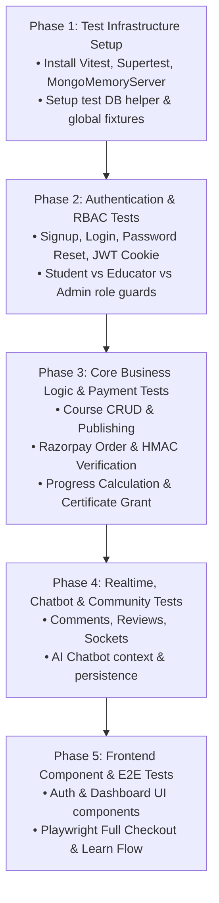

# 🧪 SkillBridge-LMS: Comprehensive Feature Audit & Testing Master Plan

> **Generated on:** 2026-11-25  
> **Project:** SkillBridge-LMS (Full-Stack Learning Management System)  
> **Architecture:** Decoupled Client-Server (Node.js/Express + React/Vite + MongoDB + Socket.io)

---

## 📌 1. Executive Summary & Tech Stack Audit

SkillBridge-LMS is an end-to-end Learning Management System with three primary user roles: **Student**, **Educator**, and **Admin**. The platform handles monetary transactions (Razorpay), video content processing/streaming (FFmpeg/Cloudinary), automated PDF certificate generation (`pdfkit`), real-time notifications (`socket.io`), and AI-assisted learning (`@google/genai`).

### System Component Stack:
| Layer | Technologies Used | Current Testing Status |
| :--- | :--- | :--- |
| **Backend API** | Node.js (ESM), Express 5.2, Mongoose 9.6, JWT, Multer | ❌ No automated test runner |
| **Database** | MongoDB (Atlas / Local Mongoose ODM) | ❌ No test DB / mock DB |
| **Realtime** | Socket.io 4.8 | ❌ Untested |
| **Media / Files** | Cloudinary, FFmpeg, HLS.js, PDFKit | ❌ Untested |
| **Payment** | Razorpay SDK (Order creation & HMAC-SHA256 verification) | ❌ Untested |
| **Frontend UI** | React 18, Vite 8, Tailwind CSS, Redux Toolkit, Redux Persist | ❌ Only ESLint installed |
| **E2E Journeys**| Browser workflows (Login -> Purchase -> Watch -> Certify) | ❌ Manual only |

---

## 🔍 2. In-Depth Feature Audit by Module

Below is the complete feature inventory extracted from all routes, controllers, models, and UI views. Each feature is mapped with its **Critical Test Scenarios** and **Vulnerabilities/Edge Cases**.

---

### Module 1: Authentication, Security & Session Management
* **Routes:** `/api/auth/*`
* **Controllers:** `backend/controller/authController.js`
* **Middleware:** `backend/middleware/isAuth.js`, `backend/middleware/isRole.js`
* **Models:** `User`

| Feature | Endpoints / Mechanism | Test Scenarios (What to Verify) | Edge Cases & Risk Points |
| :--- | :--- | :--- | :--- |
| **User Registration** | `POST /api/auth/signup` | • Valid payload returns 201 & user data.<br>• Duplicate email returns 400/409.<br>• Password hashed with bcrypt before DB save.<br>• Default role is set to `student`. | • Weak password bypass.<br>• Trimming/casing on email.<br>• Payload tampering to inject `role: "admin"`. |
| **Local Login & JWT** | `POST /api/auth/login` | • Correct credentials issue valid HTTP-only cookie + Bearer token.<br>• Wrong password returns 401.<br>• Non-existent user returns 404/401.<br>• Banned user cannot log in (403). | • Timing attack on password verification.<br>• Missing `JWT_SECRET` handling. |
| **Single-Device Session Guard** | `currentSessionId`, `sessionExpiresAt`, `clearSession` | • New login updates `currentSessionId`.<br>• Old session gets invalidated with `sessionExpired: true`.<br>• Expired session resets DB session fields. | • Race condition when two logins occur simultaneously.<br>• Session expiry clock skew. |
| **Email OTP & Password Reset** | `POST /sendotp`, `POST /verifyotp`, `POST /resetpassword` | • OTP generates with expiration timestamp.<br>• Valid OTP allows resetting password.<br>• Incorrect/expired OTP rejected. | • OTP brute-force attacks (rate limiting required).<br>• Reusing already verified OTP. |
| **Google OAuth** | `POST /api/auth/googleauth` | • Verifies Firebase Google ID token.<br>• Creates account if new user; logs in if existing user. | • Spoofed Google UID/token payload. |
| **Logout** | `GET /api/auth/logout` | • Clears auth cookies and resets active session state. | • Stale client-side token remaining in LocalStorage. |

---

### Module 2: Role-Based Access Control (RBAC) & User Management
* **Routes:** `/api/user/*`, `/api/admin/*`
* **Controllers:** `userController.js`, `adminController.js`
* **Roles:** `student`, `educator`, `admin`

| Feature | Endpoints | Test Scenarios | Edge Cases & Risk Points |
| :--- | :--- | :--- | :--- |
| **Profile Management** | `GET /api/user/getcurrentuser`<br>`PUT /api/user/updateprofile` | • Fetches sanitized user profile (no password hash).<br>• Updates name, bio, and profile photo via Multer. | • Uploading non-image/executable files.<br>• Profile picture replacement removes old file from Cloudinary. |
| **Password Change** | `PUT /api/user/changepassword` | • Validates old password before hashing new password.<br>• Rejects identical old & new password if enforced. | • Brute-forcing old password without rate limits. |
| **Admin User Moderation** | `GET /api/admin/users`<br>`PUT /api/admin/ban/:userId`<br>`PUT /api/admin/role/:userId` | • Non-admin access returns 403 Forbidden.<br>• Ban immediately blocks all `isAuth` requests.<br>• Role escalation updates permissions dynamically. | • Admin banning themselves by mistake.<br>• Demoting the last remaining admin. |

---

### Module 3: Course Creation, Modules & Curriculum Studio
* **Routes:** `/api/course/*`
* **Controllers:** `courseController.js`, `moduleController.js`, `lectureController.js`
* **Models:** `Course`, `Module`, `Lecture`

| Feature | Endpoints | Test Scenarios | Edge Cases & Risk Points |
| :--- | :--- | :--- | :--- |
| **Course CRUD** | `POST /create`<br>`PUT /editcourse/:id`<br>`DELETE /remove/:id` | • Only `educator` or `admin` can create.<br>• Educator can only edit/delete their own courses.<br>• Deleting a course cascades or cleans up modules and lectures. | • Orphaned modules/lectures left in DB on course delete.<br>• Thumbnail upload failure does not leave broken DB state. |
| **Publishing State** | `PUT /publish/:id`<br>`PUT /unpublish/:id` | • Published courses appear in `getpublished` public catalog.<br>• Unreleased courses hidden from student search and catalog. | • Unpublishing an already purchased course: enrolled students must still retain access. |
| **Module Management** | `POST /create-module/:courseId`<br>`DELETE /remove-module/:moduleId` | • Modules linked to valid `courseId`.<br>• Ordering of modules maintained in course outline. | • Module deletion with existing lectures: cascade delete or prevent? |
| **Lecture Management** | `POST /createlecture/:moduleId`<br>`POST /editlecture/:lectureId`<br>`DELETE /removelecture/:id` | • Lecture video upload handling via Multer.<br>• Video duration, title, and public/preview flag updated.<br>• Educator ownership validated. | • Uploading massive video files (timeout handling).<br>• Cleaning up uploaded video from storage on lecture delete. |

---

### Module 4: Video Processing & Lecture Resources
* **Controllers:** `lectureController.js`, `uploadLectureResource.js`
* **Dependencies:** `fluent-ffmpeg`, `ffmpeg-static`, `cloudinary`

| Feature | Endpoints | Test Scenarios | Edge Cases & Risk Points |
| :--- | :--- | :--- | :--- |
| **Video Transcoding / Upload** | `POST /editlecture/:lectureId` (videoUrl) | • Handles raw MP4/WebM uploads.<br>• Converts or stores streaming URLs for HLS playback. | • FFmpeg process crash on corrupted video file.<br>• High CPU/Memory spike during transcoding. |
| **Lecture Resources** | `POST /upload-resource/:lectureId`<br>`GET /download-resource/...`<br>`DELETE /removeresource/...` | • Supports multiple files (PDFs, ZIPs, Docs up to 20 files).<br>• Download headers set correct MIME type and disposition. | • Malicious script upload (SVG/HTML with embedded scripts).<br>• Resource access validation (only enrolled students). |

---

### Module 5: Quiz & Assessment System
* **Routes:** `/api/course/add-quiz/:lectureId`, `/get-quiz/:lectureId`, `/mark-quiz-completed/:lectureId`
* **Controllers:** `quizController.js`, `lectureController.js`

| Feature | Endpoints | Test Scenarios | Edge Cases & Risk Points |
| :--- | :--- | :--- | :--- |
| **Quiz Authoring** | `POST /add-quiz/:lectureId`<br>`DELETE /remove-quiz/:lectureId/:quizId` | • Educator adds question with options and specifies correct index.<br>• Deleting quiz updates lecture questions array. | • Adding quiz without options or without valid correct option index. |
| **Quiz Execution & Scoring** | `GET /get-quiz/:lectureId`<br>`PUT /mark-quiz-completed/:lectureId` | • Enrolled student fetches quiz questions.<br>• Submitting quiz marks `isQuizCompleted: true` in user progress. | • Student viewing correct answers directly in API response payload before answering.<br>• Re-submitting quiz multiple times. |

---

### Module 6: Enrollment, Pricing, Coupons & Razorpay Payments
* **Routes:** `/api/enrollment/*`, `/api/order/*`, `/api/coupon/*`
* **Controllers:** `enrollMentController.js`, `orderController.js`, `couponController.js`
* **Models:** `Enrollment`, `Course`, `Coupon`

| Feature | Endpoints | Test Scenarios | Edge Cases & Risk Points |
| :--- | :--- | :--- | :--- |
| **Free Course Enrollment** | `POST /api/enrollment/enroll/:courseId` | • Free courses (price === 0) enroll without payment.<br>• Duplicate enrollment prevented (`Already enrolled`). | • Attempting free enrollment on a paid course (must return 400). |
| **Razorpay Order Creation** | `POST /api/order/razorpay-order` | • Calculates correct amount (`price - discount`).<br>• Creates order with currency `INR` and receipt ID. | • Client sending arbitrary negative discount (must validate discount on server). |
| **Payment Verification & Access Grant** | `POST /api/order/verifypayment` | • Computes HMAC-SHA256 signature using `RAZORPAY_KEY_SECRET`.<br>• Match: Creates `Enrollment`, marks status `active`.<br>• Mismatch: Returns 400 signature verification failed. | • **CRITICAL:** Replay attacks (re-using same `razorpay_payment_id` for multiple courses).<br>• Concurrent duplicate webhooks/calls creating double enrollment. |
| **Coupon Validation** | `POST /api/coupon/apply` | • Validates coupon active status, expiration date, and min purchase.<br>• Respects `maxUses` limit and increments usage count. | • Applying coupon expired 1 second ago.<br>• Applying educator coupon on another educator's course. |

---

### Module 7: Learning Progress & Resume Engine
* **Routes:** `/api/course/progress/*`
* **Controllers:** `progressController.js`
* **Models:** `LectureProgress`, `Course`, `Lecture`

| Feature | Endpoints | Test Scenarios | Edge Cases & Risk Points |
| :--- | :--- | :--- | :--- |
| **Progress Updates** | `POST /api/course/progress/update` | • Updates `watchedDuration`, `lastWatchedPosition`.<br>• Automatically flags `completed: true` when > 90% watched. | • Negative timestamp or timestamp greater than lecture total duration.<br>• Student sending fake 100% completion request. |
| **Course Overall Progress** | `GET /api/course/progress/course/:courseId` | • Calculates exact percentage: `(completedLectures / totalLectures) * 100`.<br>• Returns all lecture statuses. | • Course with 0 lectures (division by zero handling).<br>• Educator deleting a lecture: progress recalculates dynamically. |
| **Resume Playback** | `GET /api/course/progress/resume/:courseId` | • Returns the last played lecture and timestamp for seamless resume. | • Newly enrolled course with zero progress starts at Lecture 1, 00:00. |

---

### Module 8: Automated PDF Certificate Generation
* **Routes:** `/api/certificate/*`, `/api/course/certificate/*`
* **Controllers:** `certificateController.js`
* **Models:** `Certificate`, `LectureProgress`

| Feature | Endpoints | Test Scenarios | Edge Cases & Risk Points |
| :--- | :--- | :--- | :--- |
| **Eligibility Validation** | `POST /api/certificate/generate/:courseId` | • Fails with 400 if course progress is < 100%.<br>• Succeeds when all lectures & quizzes are verified complete.<br>• Idempotent: returns existing certificate if already generated. | • Progress spoofing to claim certificate prematurely.<br>• Missing student name on user profile when generating PDF. |
| **PDF Rendering & Verification** | `GET /download/:courseId`, `GET /:courseId` | • Generates dynamic PDF via `pdfkit` stream with student name, course title, and completion date.<br>• Unique `certificateId` and verification hash verifiable online. | • Server memory leaks when streaming large PDFs under high concurrency.<br>• CORS / header issues on mobile browser PDF downloads. |

---

### Module 9: Community Discussions (Comments & Replies)
* **Routes:** `/api/course/comment/*`
* **Controllers:** `commentController.js`
* **Models:** `Lecture` (Embedded comments or referenced)

| Feature | Endpoints | Test Scenarios | Edge Cases & Risk Points |
| :--- | :--- | :--- | :--- |
| **Comment Threading** | `POST /comment/:lectureId`<br>`POST /comment/reply/:lectureId/:commentId` | • Enrolled student/educator can post comment.<br>• Nested reply attaches to parent comment.<br>• Returns populated user author data (name, avatar). | • Deep nested reply rendering breaking UI.<br>• Empty or whitespace-only comment submissions. |
| **Likes & Pinning** | `PUT /comment/like/...`<br>`PUT /comment/pin/...` | • Toggling like adds/removes userId from likes array.<br>• Only course creator (educator) can pin comment to top. | • Unauthenticated like manipulation.<br>• Non-creator pinning comments. |

---

### Module 10: Reviews & Ratings System
* **Routes:** `/api/review/*`
* **Controllers:** `reviewController.js`
* **Models:** `Review`, `Course`

| Feature | Endpoints | Test Scenarios | Edge Cases & Risk Points |
| :--- | :--- | :--- | :--- |
| **Course Review Creation** | `POST /api/review/createreview` | • Only enrolled students can review.<br>• Rating strictly bounded between 1 and 5.<br>• Updates course average rating and total reviews. | • Non-enrolled user submitting fake reviews.<br>• User submitting duplicate reviews for the same course. |

---

### Module 11: Real-Time Sockets & Notification System
* **Routes:** `/api/notification/*`
* **Services:** `socketNotificationService.js`, `notificationService.js`
* **Sockets:** `sockets/index.js`

| Feature | Endpoints / Events | Test Scenarios | Edge Cases & Risk Points |
| :--- | :--- | :--- | :--- |
| **Socket Connection** | `connection`, `join-room`, `disconnect` | • Authenticated client connects and joins their private room.<br>• Tracks online/offline status cleanly. | • Memory leaks from dangling socket listeners on client reload.<br>• Reconnection storms. |
| **Event Dispatches** | `new_notification`, `course_purchased`, `lecture_comment` | • Real-time event emits to recipient within < 200ms.<br>• Persists notification in MongoDB. | • Recipient is offline (notification stored for later fetch). |
| **Notification Maintenance** | `deleteOldNotifications` cron job | • Daily cleanup removes notifications older than 15 days automatically. | • Timezone calculation bugs deleting recent notifications. |

---

### Module 12: AI Tutor / Chatbot Assistant
* **Routes:** `/api/chatbot/*`
* **Controllers:** `chatbotController.js`
* **SDK:** `@google/genai` (Gemini API)

| Feature | Endpoints | Test Scenarios | Edge Cases & Risk Points |
| :--- | :--- | :--- | :--- |
| **AI Lecture Assistance** | `POST /api/chatbot/chat` | • Sends user query with lecture context to Gemini.<br>• Returns intelligent, Markdown-formatted explanation. | • Missing or exhausted Gemini API key (graceful error handling).<br>• Rate limiting user prompts to prevent API quota drain. |
| **Chat Persistence** | `POST /save`, `GET /history/:lectureId`, `PUT /favorite/:chatId` | • User can view previous chats for a lecture.<br>• Star/favorite key explanations for later revision. | • Unauthorized access to another student's chat history. |

---

### Module 13: Technical Blog CMS
* **Routes:** `/api/blog/*`
* **Controllers:** `blogController.js`
* **Models:** `BlogCategory`, `BlogCourse`, `BlogTopic`, `BlogModel`

| Feature | Endpoints | Test Scenarios | Edge Cases & Risk Points |
| :--- | :--- | :--- | :--- |
| **Hierarchical Content CMS** | Category -> Subject -> Topic -> Article | • Educators/Admins create structured tutorials.<br>• Public reading endpoint with SEO friendly slugs. | • Broken hierarchy references on parent deletion.<br>• XSS vulnerabilities in rendered Markdown content. |

---

### Module 14: Frontend Routing, Redux State & UX Flows
* **Framework:** React 18, React Router v7, Redux Toolkit
* **Critical Layouts:** `StudentLayout`, `EducatorLayout`, `AdminLayout`

| Feature | Components / Routes | Test Scenarios | Edge Cases & Risk Points |
| :--- | :--- | :--- | :--- |
| **Protected Route Guards** | `App.jsx` Route redirects | • Unauthenticated user accessing `/student/*` redirected to `/login`.<br>• Student accessing `/admin/*` redirected to `/`.<br>• Educator accessing `/educator/*` authorized. | • Flash of Unauthorized Content before user state resolves.<br>• Token expiry mid-session handling in Redux/Axios interceptors. |
| **Redux State Isolation** | `userSlice`, `progressSlice`, `courseSlice` | • Logout dispatches `clearAllProgress()` and `clearModuleData()` to prevent data leakage between users. | • Stale cache from previous logged-in user in `redux-persist`. |

---

## ⚡ 3. Critical Security & Edge-Case Vulnerabilities Matrix

| Priority | Risk Area | Potential Vulnerability | Mandatory Test Needed |
| :---: | :--- | :--- | :--- |
| **P0 (Critical)** | **Payment Verification** | Client sends fake Razorpay payment ID without signature check | Integration test with forged signature verifying 400 rejection |
| **P0 (Critical)** | **Role Escalation** | Student crafts `PUT /api/admin/role/:id` or injects `role: "admin"` on signup | Test non-admin calls to admin routes return strict 403 |
| **P0 (Critical)** | **Certificate Fraud** | Student calls `generateCertificate` directly via Postman without 100% progress | Test API rejects request with 400 when lectures/quizzes remain |
| **P1 (High)** | **Private Video Access** | Direct access to S3/Cloudinary video URLs without enrollment | Verify video streaming endpoint requires active enrollment check |
| **P1 (High)** | **Coupon Exploitation** | Applying single-use coupon concurrently across multiple tabs | Concurrency test with parallel requests testing atomic decrement |
| **P2 (Medium)** | **Mass File Upload** | Uploading 20 x 1GB files to lecture resource endpoint | Multer file size and MIME-type filter rejection test |

---

## 🏗️ 4. Recommended Testing Stack & Architecture

To achieve clean, reliable, and automated testing for SkillBridge-LMS without heavy external setup:

```
┌────────────────────────────────────────────────────────────────────────┐
│                        SkillBridge-LMS Test Suite                       │
├──────────────────────────────────┬─────────────────────────────────────┤
│        Backend Testing           │          Frontend Testing           │
├──────────────────────────────────┼─────────────────────────────────────┤
│ • Runner: Vitest (Fast ESM native)│ • Runner: Vitest + JSDOM            │
│ • HTTP Assertions: Supertest     │ • UI Testing: React Testing Library │
│ • In-Memory DB: mongodb-memory-  │ • API Mocking: MSW (Mock Service    │
│   server (isolated, fast tests)  │   Worker)                           │
│ • Mocking: Vitest vi.fn()        │ • Redux: Redux Store wrapper tests  │
├──────────────────────────────────┴─────────────────────────────────────┤
│                       End-to-End (E2E) Testing                         │
│ • Playwright (Headless Chromium, Firefox, WebKit for Full Flows)       │
└────────────────────────────────────────────────────────────────────────┘
```

### Why Vitest over Jest?
* Both Backend (`"type": "module"`) and Frontend (Vite) use native ES Modules.
* Vitest works seamlessly with ESM out-of-the-box without painful Babel/Jest transform configurations.
* 3x - 5x faster test execution.

---

## 🗺️ 5. Step-by-Step Testing Implementation Roadmap



### Phase 1: Test Infrastructure Setup (Estimated: Immediate)
* Install backend testing packages: `vitest`, `supertest`, `mongodb-memory-server`.
* Create `backend/tests/setup.js` to manage in-memory MongoDB connection and teardown per test file.
* Add `"test": "vitest run"` and `"test:watch": "vitest"` scripts to `backend/package.json`.

### Phase 2: Authentication & Role Verification (P0)
* Test suite: `auth.test.js`, `roleGuard.test.js`.
* Test all edge cases: banned accounts, invalid tokens, duplicate emails, password mismatch.

### Phase 3: Course, Payment & Certificate Pipeline (P0)
* Test suite: `course.test.js`, `payment.test.js`, `progress.test.js`, `certificate.test.js`.
* Test complete enrollment lifecycle: Free enrollment vs Paid enrollment vs Coupon discount -> 100% lecture completion -> PDF Certificate generation.

### Phase 4: Discussions, Reviews & AI Features (P1)
* Test suite: `comment.test.js`, `review.test.js`, `chatbot.test.js`.
* Mock Gemini API calls to ensure zero billing charges during tests.

### Phase 5: Frontend UI & E2E User Journeys (P2)
* Component tests for LoginForm, CourseCard, QuizModal.
* Playwright test for: `Guest -> Register -> Buy Course -> Watch Video -> Get Certificate`.

---

## 🎯 6. Immediate Next Steps

1. **Setup Backend Test Runner:** Run the installation of `vitest`, `supertest`, and `mongodb-memory-server` in the `backend` workspace.
2. **Setup In-Memory Test Database Helper:** Create the reusable DB bootstrap file so no real database data is touched.
3. **Write the First Test Suite:** Begin with **Auth & Roles (`auth.test.js`)** to establish the standard testing pattern.
